# Wellenwerk – Anleitung

Wellenwerk ist ein Programm für die Funkstation: Funkgerät steuern, Logbuch führen, Digitalbetrieb (PSK, RTTY, Olivia, MT63, SSTV und mehr), Winlink-E-Mail über Funk, Satelliten, Rotor und Karten – alles in einem Fenster.

> **Lizenz und Haftung:** Wellenwerk ist freie Software unter der GNU General Public License 3 und wird **ohne jede Gewährleistung** bereitgestellt. Die Nutzung – insbesondere die Steuerung von Sendern, Funkgeräten und Rotoren – erfolgt auf eigene Verantwortung. Für die Einhaltung der Amateurfunk-Vorschriften ist die bedienende Person verantwortlich. Einzelheiten und alle Fremdlizenzen: [LIZENZEN.md](../LIZENZEN.md) bzw. im Programm unter **Hilfe → Lizenzen und Fremdkomponenten**.

**Inhalt**
1. [Installation](#1-installation)
2. [Erster Start](#2-erster-start)
3. [Funkgerät verbinden](#3-funkgerät-verbinden)
4. [Gerätesteuerung](#4-gerätesteuerung)
5. [Fenster anordnen und Layouts](#5-fenster-anordnen-und-layouts)
6. [Rechtsklick-Menüs](#6-rechtsklick-menüs)
7. [Logbuch](#7-logbuch)
8. [DX-Cluster, Alarme und WSJT-X](#8-dx-cluster-alarme-und-wsjt-x)
9. [Online-Dienste (QRZ.com, LoTW, eQSL, Club Log)](#9-online-dienste)
10. [Digitalbetrieb](#10-digitalbetrieb)
11. [SSTV (Bildübertragung)](#11-sstv-bildübertragung)
12. [Winlink (E-Mail über Funk)](#12-winlink-e-mail-über-funk)
13. [Satelliten](#13-satelliten)
14. [Rotor](#14-rotor)
15. [Karten](#15-karten)
16. [Tastenkürzel](#16-tastenkürzel)
17. [Daten, Sicherung und Umzug](#17-daten-sicherung-und-umzug)
18. [Zugang, API und KI-Assistenten](#18-zugang-api-und-ki-assistenten)
19. [Fehlerbericht und Aktualisierung](#19-fehlerbericht-und-aktualisierung)
20. [Probleme lösen](#20-probleme-lösen)

---

## 1. Installation

Die Installationsdateien gibt es unter **Releases** in diesem Repository.

| System | Datei | Hinweis |
|---|---|---|
| Windows 10/11 | `Wellenwerk-x.y.z-Windows-Setup.exe` | Windows warnt beim ersten Start („Unbekannter Herausgeber“): **Weitere Informationen → Trotzdem ausführen**. |
| Mac mit Apple-Chip (M1–M4) | `Wellenwerk-x.y.z-Mac-AppleSilicon.dmg` | DMG öffnen, Wellenwerk in „Programme“ ziehen. Erster Start: **Rechtsklick → Öffnen**. |
| Mac mit Intel-Chip | `Wellenwerk-x.y.z-Mac-Intel.dmg` | wie oben |
| Linux | `.AppImage` oder `.deb` | AppImage ausführbar machen (`chmod +x`) und starten. Benutzer in die Gruppe `dialout` aufnehmen (`sudo usermod -aG dialout $USER`, danach neu anmelden). |

Für die Steuerung braucht es nichts weiter – die Funkgeräte-/Rotorsteuerung (Hamlib) ist eingebaut. Ggf. den **USB-Treiber des Funkgeräts** installieren (z. B. Silicon Labs CP210x bei Icom und Yaesu, FTDI bei manchen Kenwood/Elecraft).

## 2. Erster Start

Beim ersten Start öffnen sich die **Programmoptionen**. Tragen Sie mindestens **Rufzeichen** und **Locator** ein – sie werden für Entfernungen, Richtungen, Makros, den DX-Cluster und die Logbuch-Uploads gebraucht.

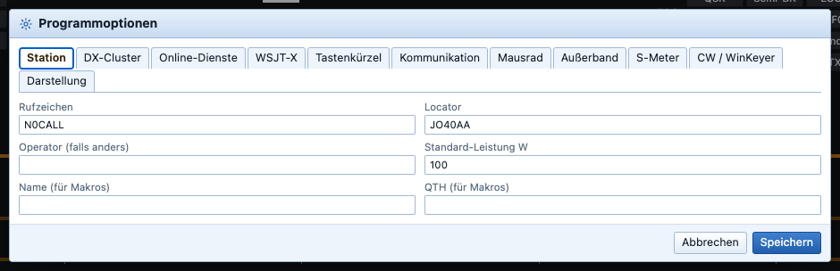

Die Optionen erreichen Sie jederzeit mit **F8** oder über **Optionen** in der Werkzeugleiste. Wichtige Registerkarten:

- **Station:** Rufzeichen, Locator, Name/QTH für Makros
- **DX-Cluster:** Server (z. B. `dxc.ve7cc.net`, Port 23) und Anmeldebefehle
- **Online-Dienste:** Zugangsdaten für Callbook und Uploads (siehe [Kapitel 9](#9-online-dienste))
- **WSJT-X:** UDP-Port (Standard 2237)
- **Kommunikation:** wie oft das Funkgerät abgefragt wird
- **CW / WinKeyer:** CW über das Funkgerät oder einen K1EL-WinKeyer
- **Darstellung:** Farbschema (Klassisch, Hell, Dunkel, Nachtsicht)

Zum Ausprobieren ist ein **Demo-Funkgerät** voreingestellt – damit lässt sich alles bedienen, ohne dass ein Gerät angeschlossen ist.

## 3. Funkgerät verbinden

**Gerätesteuerung → Verbinden** (oder das Stecker-Symbol in der Werkzeugleiste).

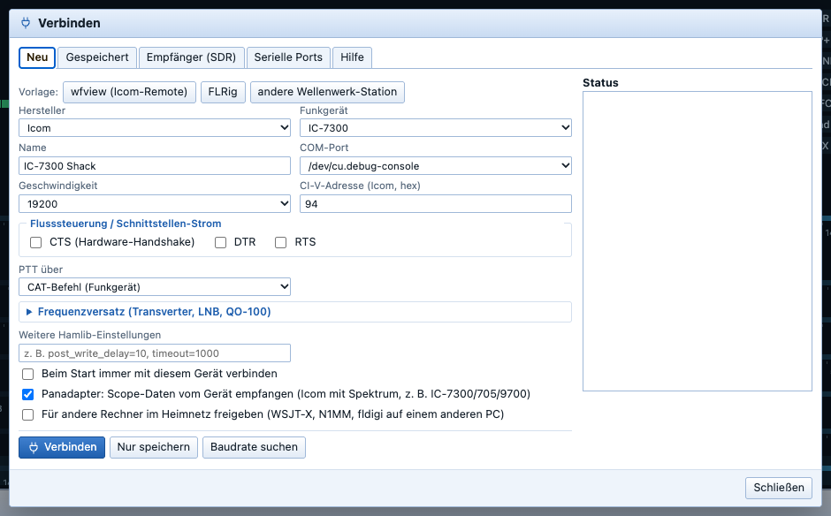

1. **Hersteller** und **Funkgerät** wählen (über 300 Modelle).
2. **COM-Port** wählen. Unter Windows `COM3`, `COM4` …, am Mac `/dev/cu.usbserial-…` bzw. `/dev/cu.SLAB_USBtoUART`, unter Linux `/dev/ttyUSB0`. Die Registerkarte **Serielle Ports** zeigt, welcher Port zu welchem USB-Gerät gehört.
3. **Geschwindigkeit** wie im Menü des Funkgeräts (CAT/CI-V-Baudrate). Unbekannt? **Baudrate suchen** probiert alle durch.
4. **Icom:** CI-V-Adresse eintragen (z. B. IC-7300 = 94, IC-705 = A4, IC-9700 = A2). Im Gerät „CI-V USB Echo Back“ meist aus.
5. **PTT über:** normalerweise „CAT-Befehl“. Bei Interfaces ohne CAT-PTT: DTR- oder RTS-Leitung.
6. **Verbinden**. Antwortet das Gerät nicht, steht die Ursache im Feld **Status**.

Weitere Einstellungen:
- **Beim Start immer verbinden** – für das Hauptgerät.
- **Panadapter: Scope-Daten vom Gerät** – bei Icom-Geräten mit eingebautem Spektrum (IC-7300/705/9700/7610 …). Im Gerät „CI-V USB Port“ auf **Unlinked** und 115200 Baud stellen.
- **Für andere Rechner freigeben** – siehe unten.
- **Frequenzversatz (Transverter, LNB, QO-100)** – siehe unten.

**Frequenzversatz für Transverter und QO-100:** Im aufklappbaren Bereich **Frequenzversatz** (bei eingetragenem Versatz automatisch offen) werden ein RX- und ein TX-Versatz in MHz im Geräteprofil gespeichert. Wellenwerk zeigt dann überall die tatsächliche Frequenz an (Gerätefrequenz + Versatz) und rechnet beim Abstimmen zurück. Der **TX-Versatz** gilt für die Sendefrequenz im Split-Betrieb (VFO B); leer bedeutet „wie RX“. Der Knopf **QO-100** trägt RX 9750 MHz (LNB) und TX 1968 MHz (Aufwärtsumsetzer 432 → 2400 MHz) ein, **Transverter 2 m** je 116 MHz (28 → 144 MHz). Beispiel QO-100 mit Split: Empfang auf 10489,550 MHz (Gerät 739,550 MHz), Senden auf 2400,050 MHz (Gerät 432,050 MHz). Den LNB-Versatz bei Bedarf um die Ablage des eigenen LNB korrigieren (z. B. 9749,982). Programme, die das Gerät über die Freigabe mitbenutzen (WSJT-X …), sehen weiter die Gerätefrequenz.

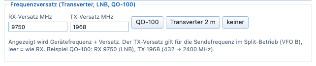

**Mehrere Funkgeräte** gleichzeitig: einfach nacheinander verbinden. Jedes Gerät bekommt einen eigenen Reiter oben in der Gerätesteuerung.

**Funkgerät mit anderen Programmen teilen** (WSJT-X, JTDX, N1MM, fldigi, Log4OM): In der Registerkarte **Gespeichert** steht in der Spalte „Für andere Programme“ eine Adresse wie `127.0.0.1:4600`. Im anderen Programm als Funkgerät **Hamlib NET rigctl** mit dieser Adresse wählen. Beide Programme steuern dann dasselbe Gerät gleichzeitig.

**Entfernte Station über wfview, FLRig oder eine andere Wellenwerk-Station:** Im Verbinden-Dialog oben eine **Vorlage** wählen. Bei **wfview** (Icom-Geräte im Netz/Internet) in wfview *Einstellungen → External Control → Enable RigCtld* einschalten; wfview verbindet sich mit der entfernten Station, Wellenwerk steuert über Port 4533. Den Ton liefert wfview als virtuelle Soundkarte.

**Programme ohne Hamlib-Netzanbindung** (nur „serielles Funkgerät“): **F8 → Kommunikation → CAT-Emulation** einschalten. Wellenwerk verhält sich dann wie ein **Kenwood TS-2000**. Unter macOS/Linux erscheint ein Port wie `/dev/ttys003` (zusätzlich immer als `~/.wellenwerk-cat`), unter Windows ein virtuelles Port-Paar mit **com0com** anlegen, das eine Ende (z. B. COM11) in Wellenwerk eintragen, das andere (COM12) im Fremdprogramm; alternativ ein TCP-Port. Im Fremdprogramm „Kenwood TS-2000“, 9600 Baud wählen. Frequenz, Betriebsart, PTT, S-Meter, Leistung und Lautstärke werden an das gerade gewählte Funkgerät weitergegeben.

## 4. Gerätesteuerung

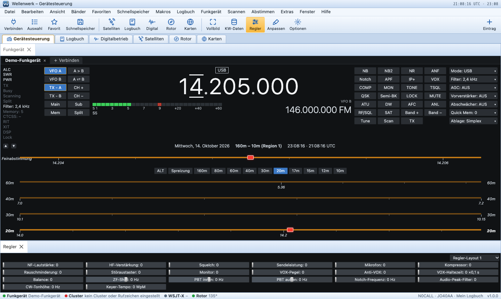

- **Frequenzanzeige:** Mausrad über einer Ziffer verstellt genau diese Stelle. Klick auf eine Ziffer macht sie „aktiv“ (Balken), dann **↑/↓** oder **+/−** zum Verstellen, **←/→** zum Wechseln, Zifferntasten zum Eintippen. **Enter** öffnet die Frequenzeingabe.
- **Betriebsart:** Schaltfläche über der Frequenz.
- **Links:** VFO A/B, TX-A/B, A>B, A⇄B, Main/Sub, Speicher, Kanal ±. **Rechts:** Funktionstasten (NB, NR, Notch, ATU, Tune …) und Auswahllisten (Filter, AGC, Vorverstärker, Abschwächer …). Welche Tasten erscheinen, hängt davon ab, was das Gerät kann.
- **Feinabstimmung:** die Leiste unter der Anzeige; ziehen oder Mausrad (Shift = doppelt, Strg = fünffach).
- **Bandtasten:** Klick springt auf die zuletzt benutzte Frequenz und Betriebsart des Bandes. **ALT** stimmt den zweiten VFO ab, **Spreizung** zeigt ein Band über mehrere Leisten.
- **Abstimmleisten:** je Band eine Leiste über den ganzen Bandbereich; Klick oder Ziehen stimmt ab. Cluster-Spots erscheinen als Marken.
- **Regler** (unten): bis zu sechs Regler-Layouts, z. B. eines für SSB und eines für CW.
- **Favoriten** (Werkzeugleiste **Auswahl**): Frequenzen mit Betriebsart in Ordnern speichern, Klick stimmt ab.
- **Schnellspeicher:** merkt die aktuelle Frequenz als Marke auf der Abstimmleiste.

Weitere Fenster über **Ansicht** bzw. **Extras**: Kurzwellen-Datenbank (Rundfunksender nach Frequenz und Zeit), Bandübersicht (fährt ein Band ab und zeichnet das S-Meter), Scanner, Makros, Sprachspeicher, **Panadapter**, **Speicherkanäle**.

**Layout anpassen** (**Strg+F8**): Tasten zwischen links und rechts verschieben, eigene Tasten anlegen (Betriebsart, Frequenz, CAT-Befehl, Makro), Farben, Größe, Regler-Layouts und Bandplan (Region 1/2/3). Mit **Layout als Datei speichern / laden** lässt sich das Layout auf andere Rechner übertragen.

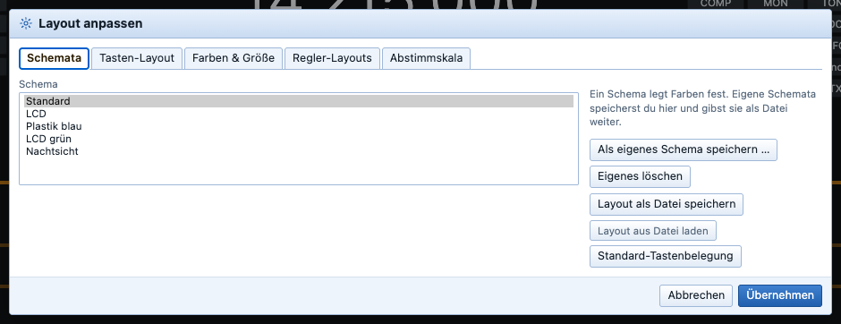

### Panadapter und Speicherkanäle

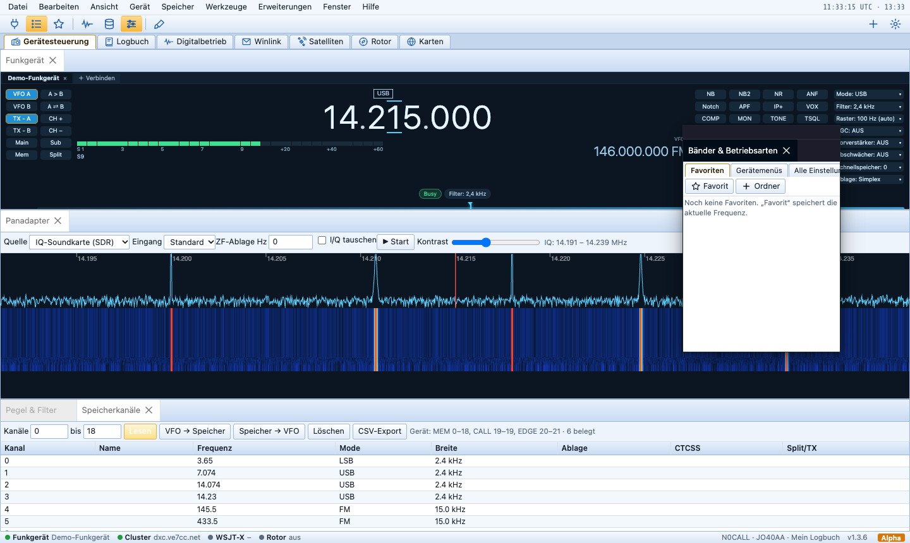

- **Panadapter** (oben im Bild): Spektrum und Wasserfall; Klick stimmt ab. Quelle entweder das **Scope des Funkgeräts** (Icom) oder eine **IQ-Soundkarte** (SDR, z. B. über DAX-IQ oder einen IQ-Ausgang). Bei IQ: Eingang wählen, **Start**; bei Bedarf **ZF-Ablage** und **I/Q tauschen** (wenn das Spektrum gespiegelt ist).
- **Speicherkanäle** (unten im Bild): **Lesen** holt die Kanäle aus dem Gerät. Kanal anklicken, dann **Speicher → VFO** (oder Doppelklick), **VFO → Speicher** oder **Löschen**. **CSV-Export** speichert die Liste.

### Schnappschüsse und Synchronisieren

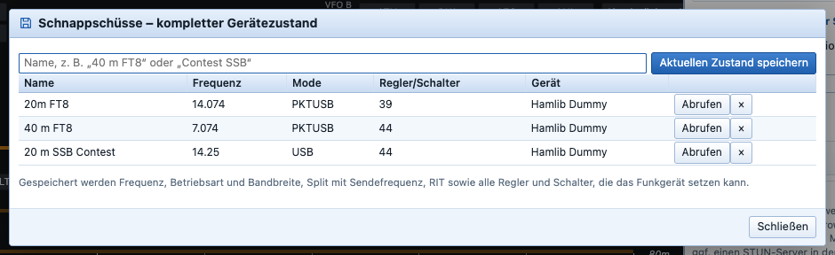

**Funkgerät → Schnappschüsse …** speichert den kompletten Gerätezustand unter einem Namen – Frequenz, Betriebsart und Bandbreite, Split mit Sendefrequenz, RIT und alle Regler und Schalter, die das Gerät setzen kann – und stellt ihn mit **Abrufen** wieder her (z. B. „40 m FT8“, „Contest SSB“). Einmal-Aktionen wie Tuner-Start oder Tonruf werden dabei nie ausgelöst.

**Funkgerät → Synchronisieren …**: Ein zweites verbundenes Gerät folgt dem ersten – Frequenz plus einstellbarer **Versatz** und auf Wunsch die Betriebsart (Zweitempfänger, SDR als Panadapter, Transverter-ZF).

### Empfänger ohne eigenes Funkgerät (KiwiSDR, OpenWebRX, WebSDR)

Wellenwerk kann öffentliche Internet-Empfänger wie ein Funkgerät benutzen – zum Hören, für den Digitalbetrieb oder als zweiten Empfänger neben dem eigenen Gerät. Ideal auch zum Ausprobieren ohne Lizenz und ohne Funkgerät.

1. **Datei → Empfänger (WebSDR/KiwiSDR) …** (oder im Verbinden-Dialog der Reiter **Empfänger (SDR)**). Die Liste zeigt über 1800 öffentliche Empfänger aus receiverbook.de und kiwisdr.com, nach Entfernung zur eigenen Station sortiert. Filter: Art, Suchtext (Ort, Rufzeichen, Locator, Antenne), **freie Plätze**, **empfängt aktuelle Frequenz**.
2. **verbinden** macht den Empfänger zum Hauptgerät; **2. Empf.** verbindet ihn zusätzlich, das eigene Funkgerät bleibt Hauptgerät.
3. Ton, S-Meter und Wasserfall kommen sofort; Abstimmen, Betriebsart, Lautstärke, AGC und Störaustaster wie beim Funkgerät. Senden ist bei Empfängern natürlich gesperrt.

Ist ein Empfänger das aktuelle Gerät, zeigt die Geräteanzeige nur die Bänder, die er empfangen kann, und oben neben den Geräte-Reitern eine **Auswahlliste mit weiteren Empfängern** (freie Plätze, nach Entfernung) – ein Klick wechselt den Server; klappt das nicht, verbindet Wellenwerk wieder mit dem vorherigen.

**Fenster „Empfänger“** (*Ansicht*): alle verbundenen Empfänger mit eigener Frequenz, Betriebsart, Lautstärke, Ton an/aus, S-Meter und kleinem Wasserfall. **folgt dem Hauptgerät** lässt einen Zweitempfänger der Frequenz des Funkgeräts folgen (z. B. zum Vergleich mit einer entfernten Antenne).

**Eigene Adresse und Parameter:** unten im Reiter einen Empfänger direkt eintragen. Parameter mit `;` getrennt, z. B. `password=…; span=200; freq=7074; mode=USB; user=Name` (KiwiSDR) oder `profile=40m; smeter_offset=-30` (OpenWebRX).

**Digitalbetrieb:** als Eingang **Empfänger (WebSDR/KiwiSDR)** wählen – PSK, RTTY, SSTV usw. dekodieren dann den Ton des Empfängers.

**Eigene SDR-Hardware** (unten im Reiter, „Empfänger direkt eintragen“):
- **RTL-SDR-Stick:** das Programm `rtl_tcp` (Paket *rtl-sdr*) starten und als Adresse `127.0.0.1:1234` eintragen – oder Parameter `start=1`, dann startet Wellenwerk es selbst. Kurzwelle ohne Konverter: `direct=2` (z. B. RTL-SDR Blog V3), mit Konverter `offset=125000000`. Mit LNB oder Transverter davor `rx_offset=…` in Hz – für QO-100 mit LNB 9750 MHz `rx_offset=9750000000`, dann zeigt Wellenwerk 10489,5 MHz an. Weitere Parameter: `gain=30`, `ppm=…`, `rate=1536000`.
- **Hermes Lite 2** (und andere openHPSDR-Geräte): Adresse leer lassen – Wellenwerk sucht das Gerät im Netz – oder die IP eintragen. Parameter `rate=192000`, `gain=20`. In dieser Version nur Empfang.

Wellenwerk berechnet Spektrum, Wasserfall und Ton (USB, LSB, CW, AM, FM) selbst; das S-Meter ist nicht kalibriert (`smeter_offset=…`).

**WebSDR.org-Empfänger** (Universität Twente u. a.) haben keine offene Schnittstelle: **im Browser** öffnet ihre Seite auf der aktuellen Frequenz.

> Die Empfänger sind freiwillige Angebote von Funkamateuren mit wenigen Plätzen – bitte nach Gebrauch trennen.

### Wasserfall und 3D-Wasserfall

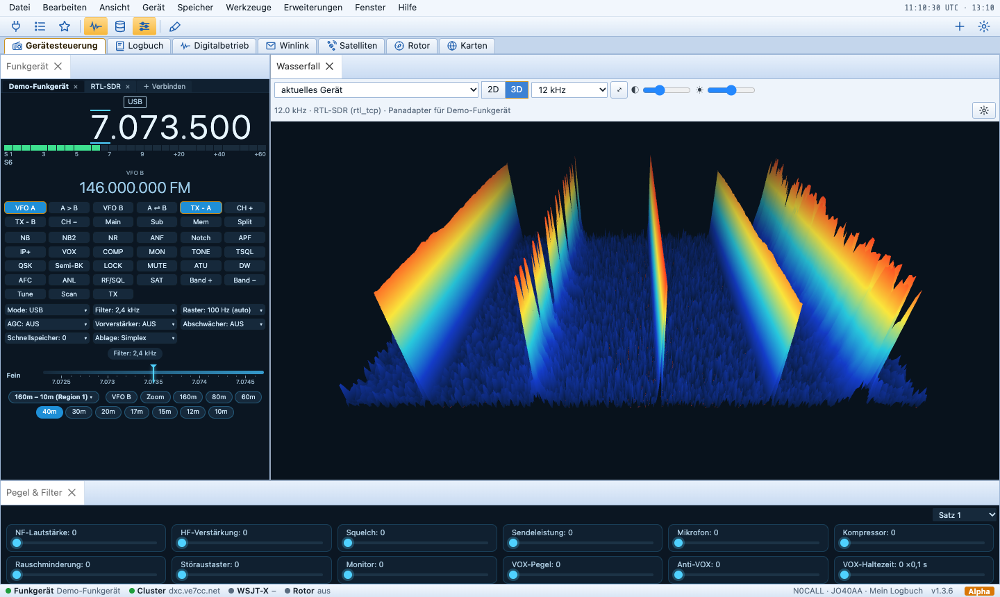

**Ansicht → Wasserfall (2D/3D)** zeigt Spektrum und Wasserfall jeder Quelle (Empfänger oder Scope des Funkgeräts; oben wählbar). **2D:** Mausrad zoomt, Ziehen verschiebt, Klick stimmt ab, der Durchlassbereich ist hell hinterlegt. **3D:** die letzten Zeilen als Landschaft – Ziehen dreht, Mausrad ändert den Abstand. Auch im Fenster **Empfänger** stimmt ein Klick in den kleinen Wasserfall den Empfänger auf die angeklickte Frequenz ab.

In der Leiste über dem Wasserfall:
- **Breite** – angezeigter Ausschnitt von 3 kHz bis 1,5 MHz oder **ganzer Bereich** (⤢). Der Ausschnitt liegt um die Empfangsfrequenz und wandert mit, wenn man aus dem Bild abstimmt. Bei SDR-Hardware (RTL-SDR, Hermes Lite 2) rechnet Wellenwerk schmale Ausschnitte mit feinerer Auflösung neu (bei 12 kHz etwa 12 Hz je Punkt statt 750 Hz), beim KiwiSDR wird dessen Zoom gestellt, bei Icom-Geräten mit Scope die Spanne des Geräts.
- **Kontrast** (◐) und **Helligkeit** (☀) wie bei SDR-Programmen: Kontrast spreizt den Pegelbereich, Helligkeit hebt oder senkt den Rauschboden. Doppelklick setzt einen Regler zurück. Die automatische Pegelanpassung läuft darunter weiter.

Der Wasserfall läuft mit fester Geschwindigkeit, auch wenn eine Quelle ihre Zeilen stoßweise schickt (KiwiSDR, OpenWebRX, Internet): Wellenwerk zeigt die Zeilen um einen kleinen Vorlauf verzögert und blendet zwischen ihnen über. Geschwindigkeit, Farben, Pegel und 3D-Tiefe unter **F8 → Wasserfall**.

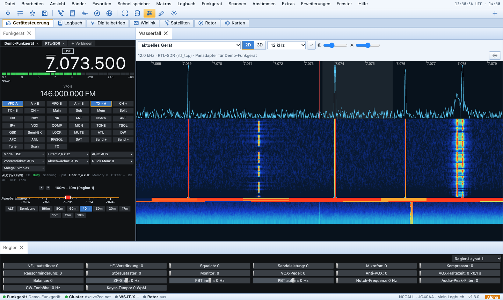

### SDR als Panadapter für ein Funkgerät ohne Scope

Viele Funkgeräte haben kein eigenes Spektrum. Wird zusätzlich ein SDR verbunden – z. B. ein **RTL-SDR** an derselben Antenne (über ein Antennenrelais/TX-Schutz oder an einem eigenen Empfangsdraht) –, übernimmt es die Rolle des Panadapters:
1. Funkgerät wie gewohnt verbinden, dann das SDR über **Verbinden → Empfänger (SDR)** als **2. Empf.** dazu verbinden.
2. Im **Wasserfall** (Quelle „aktuelles Gerät“) und im Fenster **Panadapter** erscheint jetzt das Spektrum des SDR, oben steht „Panadapter für …“.
3. Das SDR folgt Frequenz und Betriebsart des Funkgeräts. Ein Klick in den Wasserfall stimmt das **Funkgerät** ab; bedient wird das Funkgerät ganz normal.

Das SDR bleibt trotzdem ein vollwertiger Empfänger: im Fenster **Empfänger** lässt sich sein Ton einschalten, und **als Hauptgerät** macht es zum aktuellen Gerät – dann stimmt ein Klick wieder das SDR selbst ab. In der Quellenauswahl des Wasserfalls kann man auch ausdrücklich „… als Panadapter für …“ wählen. Unter **F8 → Wasserfall → SDR als Panadapter** lässt sich die Automatik abschalten oder ein bestimmtes SDR festlegen; Funkgeräte mit eigenem Scope (Icom) behalten in der Automatik ihr Scope. Hat das Funkgerät einen Frequenzversatz (z. B. QO-100), braucht das SDR denselben Empfangsversatz (`rx_offset`), damit es folgen kann.

Empfänger-Ton wird mit etwa einer halben Sekunde Vorlauf abgespielt; bei stockender Internetverbindung wächst der Puffer selbst (bis 2 s). Bricht die Verbindung zu einem Empfänger ab, verbindet Wellenwerk sich von selbst neu. Nach einem Neustart oder einer Aktualisierung werden die vorher verbundenen Geräte und Empfänger wieder verbunden – mit der zuletzt eingestellten Frequenz und Betriebsart.

### Abstimmraster

Frequenzen zwischen den Kanälen bringen nichts – Wellenwerk stimmt deshalb im **Raster des Bandes** ab. Die Auswahl **Raster** am Gerät zeigt den aktuellen Schritt; „automatisch“ wählt ihn nach Band und Betriebsart:

| Bereich / Betriebsart | Raster |
|---|---|
| Lang- und Mittelwelle (AM) | 9 kHz (Region 1), 10 kHz (Region 2) |
| Kurzwellen-Rundfunkbänder (AM) | 5 kHz |
| CB-Funk | 10 kHz (Kanäle 26,965 … 27,405 MHz) |
| 10 m und 6 m FM | 10 kHz |
| UKW-Rundfunk | 50 kHz |
| Flugfunk (AM) | 8,33 kHz |
| 2 m FM, Freenet, Seefunk, 23 cm | 12,5 kHz |
| 70 cm FM (auch DMR/D-STAR), PMR446 | 6,25 kHz |
| SSB | 100 Hz |
| CW, Digitalbetrieb | 10 Hz |

Von Hand lässt sich jeder Schritt von 10 Hz bis 100 kHz festlegen. Ein **Klick in den Wasserfall** rastet im Raster ein (die Signalerkennung legt ihre gemessene Frequenz ebenfalls aufs Raster, AM-Rundfunk z. B. auf 5 kHz), **Bild ↑/Bild ↓** gehen einen Schritt weiter, und das Mausrad auf der Abstimmskala springt bei Kanalrastern von Kanal zu Kanal.

### Markierungen im Wasserfall: typische Frequenzen, Rundfunk, Relais

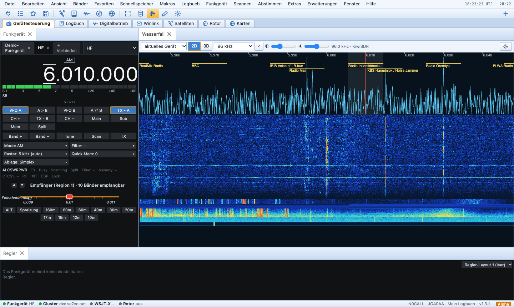

Unter der Frequenzskala zeigt der Wasserfall, was wo zu erwarten ist – ein Klick auf eine Markierung stellt Frequenz **und** Betriebsart ein, das Überfahren mit der Maus zeigt Einzelheiten:
- **Typische Frequenzen** (türkis): FT8, FT4, WSPR, JS8, PSK31, RTTY, SSTV, FreeDV, QRP- und Notfunk-Aktivitätszentren, Anruffrequenzen, APRS, ISS, NCDXF-Baken, QO-100-Baken; dazu Wetter- und Zeitsender (DWD-RTTY und -Fax, NAVTEX, VOLMET, DCF77, WWV), CB-, PMR446- und Freenet-Kanäle, Seefunk 16/70, AIS, Flugnotfunk. Die Liste gehört zum Programm und wird täglich aus dem Projekt auf GitHub aktualisiert – Ergänzungen kommen also ohne neue Version an.
- **Rundfunk** (gelb): Sender, die **jetzt** auf dieser Frequenz senden, aus dem Sendeplan EiBi (eibispace.de) mit Sprache und Zielgebiet.
- **Relais** (grün = FM, blau = digital): Relais im Umkreis (Standard 100 km) mit Rufzeichen, Betriebsart, CTCSS bzw. DMR-Colorcode. Mittelpunkt ist der **Standort des Empfängers** (OpenWebRX meldet ihn) – bei eigenen Geräten (RTL-SDR, Funkgerät) die eigene Station (Locator). Quellen: DARC-Relaisliste von DL3EL (relais.dl3el.de – sie führt auch EchoLink, IRLP, D-STAR, Wires-X, DMR und FM-Funknetz zusammen), EchoLink direkt (weltweit, mit aktuellem Status), BrandMeister (DMR, mit letztem Kontakt) und hearham.com. Nennt eine Quelle nur die Ausgabefrequenz, ergänzt Wellenwerk die übliche Ablage (2 m −600 kHz, 70 cm −7,6 MHz).

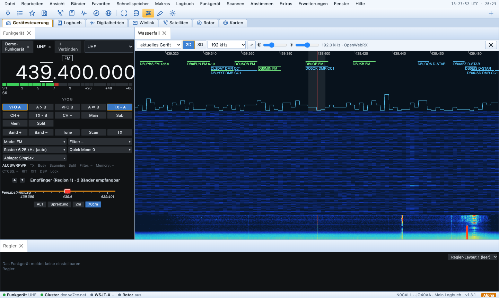

**Relais: nichts raten.** Ein Klick auf ein Relais – oder irgendwo in dessen Kanal – nimmt die Daten aus der Datenbank: Bei **DMR, D-STAR, YSF** schaltet Wellenwerk am OpenWebRX direkt den passenden Dekoder ein, bei **FM-Relais** stellt es an einem echten Funkgerät auch **Ablage und CTCSS-Ton** ein. Die Karte zeigt Rufzeichen, Ablage, Ton bzw. Colorcode, Ort, Entfernung und Quelle. Nur Frequenzen, die in keiner Liste stehen, werden mit der Signalerkennung ermittelt. Ein- und ausschalten lassen sich die drei Arten unter **F8 → Wasserfall**. Die Listen werden im Datenordner zwischengespeichert und höchstens einmal pro Woche neu abgerufen.

### Signalerkennung per Klick

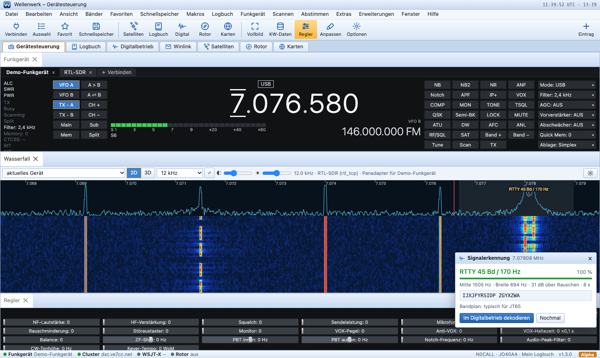

Welche Betriebsart ist das? In **USB/LSB** genügt ein Klick auf das Signal im Wasserfall (Fenster **Wasserfall**, **Empfänger** oder im Wasserfall des **Digitalbetriebs**). Wellenwerk stimmt so ab, dass das Signal bei 1500 Hz im Ton liegt, hört bis zu 15 Sekunden zu und zeigt in einer kleinen Karte, was es erkannt hat – mit Sicherheit in Prozent, Mitte, Breite und Abstand zum Rauschen:

- **Digitalbetrieb:** RTTY (mit Baud und Shift), SITOR-B/NAVTEX, PSK31/63/125, QPSK, CW (mit Tempo), Hellschreiber, MFSK, Olivia/Contestia, DominoEX/THOR, MT63, ALE
- **WSJT-Verfahren:** FT8, FT4 (an ihren Synchronmustern), WSPR, JT9, JT65
- **Bild und Sprache:** SSTV (mit Modus, z. B. „Martin M1“), Wetterfax, FreeDV, Sprache (auch „anderes Seitenband“), AM-Rundfunk, unmodulierter Träger

Wo Wellenwerk selbst dekodieren kann, wird zur Bestätigung probehalber dekodiert; lesbarer Text erscheint in der Karte. Knöpfe führen direkt weiter: **Im Digitalbetrieb dekodieren** (Betriebsart, Baud/Shift und Tonfrequenz werden übernommen), **SSTV-Empfang öffnen**, **FreeDV öffnen**, **Als LSB abstimmen**, **AM/CW einstellen** oder bei FT8 **Auf die Standardfrequenz abstimmen**. Erkannte Signale bekommen im Wasserfall für 30 Sekunden ein Etikett.

**Automatisch umschalten und live mitlesen:** Nach der Erkennung stellt Wellenwerk AM-Rundfunk auf AM und Sprache im falschen Seitenband auf das richtige Seitenband um. Bei Betriebsarten, die Wellenwerk dekodiert (RTTY, PSK, CW, MFSK, Olivia, Contestia, DominoEX, THOR, MT63 …), läuft der Text danach **live in der Karte** weiter – mit **Stopp**; die Anzeige endet von selbst, wenn umgestimmt wird. Abschaltbar unter **F8 → Wasserfall**.

**Signal suchen statt raten:** Wellenwerk sucht das Signal zuerst im Spektrum – den belegten Bereich, der dem Klick am nächsten liegt – und wertet nur diesen aus; Nachbarsignale und Rauschen im übrigen Durchlassbereich werden weggefiltert. Ein Klick daneben oder ein zu breites Filter stören deshalb kaum noch.

**FT8 und FT4 liest Wellenwerk selbst** (Dekoder ft8_lib): Ein Klick irgendwo ins FT8-Band genügt. Wellenwerk wartet, bis ein ganzer Zeitschlitz (15 s, FT4 7,5 s, nach UTC) aufgenommen ist, liest die Telegramme und zeigt danach **live jeden Zeitschlitz** in der Karte – mit Name und Ort zu bekannten Rufzeichen, z. B. „CQ DO5HOK JO41 (Holger, Harsewinkel)“. WSJT-X wird dafür nicht gebraucht; die Rechneruhr sollte genau gehen (Abweichung unter einer Sekunde).

**Genau abstimmen:** Ein Klick trifft selten exakt. Nach der Erkennung stimmt Wellenwerk deshalb selbst nach (Hinweis in der Karte, z. B. „auf Signalmitte abgestimmt (−240 Hz)“):
- **Datensignale und CW** (RTTY, PSK, Olivia, CW …): Die gemessene Signalmitte kommt genau auf 1500 Hz im Ton.
- **SSB-Sprache:** Bei USB/LSB ist nicht die Signalmitte der Abstimmpunkt, sondern der unterdrückte Träger an der Kante des Seitenbands. Wellenwerk misst, wo die Sprache im Ton beginnt (richtig abgestimmt etwa 300 Hz über dem Träger), und stimmt auf den Träger. Liegt die Sprache im falschen Seitenband, wird auf das richtige Seitenband umgeschaltet und der Träger an der Oberkante gesucht. Ist die Lage nicht sicher bestimmbar (die Filter der Geräte schneiden unterschiedlich ab), bleibt die Abstimmung unverändert.
- **AM:** auf den Träger. AM erkennt Wellenwerk beim SDR-Wasserfall auch am HF-Spektrum (Träger mit zwei gleich starken Seitenbändern), selbst wenn der Empfänger auf USB steht.

**Signal-Datenbank:** Unter dem Ergebnis nennt die Karte bekannte Signale, die auf dieser Frequenz mit passender Modulation und Breite vorkommen – aus einem Auszug des *Signal Identification Wiki* ([sigidwiki.com](https://www.sigidwiki.com), rund 550 Einträge: Name, Frequenzen, Modulation, Bandbreite). Ein Klick öffnet die Beschreibung mit Hörprobe und Wasserfallbild.

**VHF/UHF: DMR, D-STAR, APRS, Funksensoren, Wettersonden.** Viele OpenWebRX-Empfänger (z. B. „OpenWebRX+“) haben eigene Dekoder. Wellenwerk nutzt sie: Ein Klick oberhalb von 30 MHz misst im HF-Spektrum die **Mitte des Signals** (das dem Klick nächste – ein starker Nachbarkanal zieht nicht weg), stellt den Empfänger auf FM und genau auf diese Mitte – liegt sie innerhalb der Messgenauigkeit am Kanalraster (6,25 kHz), auf das Raster – und probiert dann
- nach Frequenz: **APRS** (144,800 MHz u. a.), **Funksensoren** von Wetterstationen, Thermometern usw. (433,05–434,79 MHz und 868 MHz, Auswertung mit rtl_433 auf dem Server), **Wettersonden** (400–406 MHz, falls der Server sie anbietet),
- sonst die digitalen Sprachverfahren **DMR, D-STAR, YSF (C4FM), M17, NXDN, P25**.

**Schnell und gleichzeitig:** Wellenwerk wertet das Signal selbst aus – bei eigenen Geräten (RTL-SDR, Hermes Lite 2 …) direkt aus den IQ-Daten, bei OpenWebRX und KiwiSDR aus dem FM-Ton. In 1,5 Sekunden werden die Synchronmuster aller Verfahren **auf einmal** gesucht (DMR mit Basis-/Mobilstation und Sprache/Daten, D-STAR, YSF, P25, NXDN48/96, M17); gleichzeitig prüft Wellenwerk, ob analoges FM mit Sprache oder Unterton vorliegt. Ergebnis meist nach 2–3 Sekunden. Bei einem OpenWebRX wird danach direkt der passende Dekoder eingeschaltet – kein Durchprobieren mehr (ein Server gibt jeder Verbindung nur einen Demodulator; mehrere Verbindungen gleichzeitig würden Plätze belegen und eine Sperre auslösen). Findet die eigene Erkennung nichts und ist das Signal nicht analog, probiert Wellenwerk die Dekoder des Servers wie bisher nacheinander durch (zuerst die nach gemessener Breite wahrscheinlichsten). Bei eigenen Geräten zeigt die Karte das erkannte Verfahren; das Auslesen der Inhalte (Kennungen, Rufzeichen) direkt in Wellenwerk folgt Schritt für Schritt.

Sendet die Station beim Klick gerade nicht (Relais in der Pause, DMR zwischen den Aussendungen), wird nachgestimmt, sobald das Signal erscheint. Solange der Dekoder läuft, führt Wellenwerk die Frequenz weiter nach (Sender mit Ablage oder Drift); von Hand umstimmen beendet das. In den Schmalband-Segmenten (z. B. 144,0–144,5 und 432,0–432,5 MHz, QO-100-Schmalband) wird wie auf Kurzwelle mit SSB/CW-Erkennung gearbeitet.

**Analoges FM:** Findet keiner der Digitaldekoder etwas, hört Wellenwerk 6 Sekunden in den FM-Ton und meldet **FM-Sprechfunk**, **FM mit Packet-/APRS-Tönen** oder anderen Daten, einen **CTCSS-Unterton** (z. B. „CTCSS 123 Hz“ – der Ton, den man zum Öffnen eines Relais braucht), einen **Träger ohne Modulation** oder **nur Rauschen**.

**Schutz vor Sperren:** OpenWebRX+-Server sperren Adressen für 12 Stunden, wenn Profile zu schnell hintereinander gewechselt werden (Schutz vor Robotern). Wellenwerk hält zwischen zwei Profilwechseln mindestens 10,5 Sekunden Abstand (Hinweis „Profilwechsel in … s“) und versucht es nach einer Sperre nicht erneut; die Meldung lautet dann „der Betreiber hat diese Internet-Adresse gesperrt“. Ist ein Server voll, wartet Wellenwerk mehrere Minuten bis zum nächsten Versuch.

Die Karte zeigt die Meldungen live – **mit Namen**: bei DMR Zeitschlitz, **wer spricht** (DMR-ID → Rufzeichen, Vorname, Ort aus der RadioID-Datenbank) und **in welcher Talkgroup** (Nummer und Name, z. B. „TG 262 Deutschland“, aus der BrandMeister-Liste), bei D-STAR, YSF und M17 Rufzeichen mit Name, bei NXDN die ID mit Rufzeichen, bei APRS Rufzeichen, Text und Position, bei Sensoren Modell, Temperatur (in °C), Feuchte, Wind, Regen. Kennungen, die in keiner Liste stehen (z. B. aus anderen Netzen als BrandMeister), bleiben als Zahl stehen. Die Namenslisten (rund 300 000 Einträge) lädt Wellenwerk einmal pro Woche in den Datenordner; nachgeschlagen wird nur auf dem eigenen Rechner.

**Weitere Dekoder der Empfänger:** Bietet ein OpenWebRX+ sie an, stehen im Fenster *Datenempfang* und in der Karte auch **FT8, FT4, WSPR, JT65, JT9, FST4, Q65, MSK144, JS8Call** (mit Name zum Rufzeichen), **PSK31/63, RTTY** (auch 50 Bd/450 Hz des Wetterdienstes), **CW, NAVTEX, SITOR-B, DSC, AIS** (Schiffe), **ADS-B/Mode S** (Flugzeuge mit Kennung, Höhe, Geschwindigkeit, Position), **LoRa-APRS, Meshtastic, MeshCom, MeshCore** und **FANET** zur Verfügung. Ein Klick auf 162 MHz (AIS), 1090 MHz (ADS-B), 433,775 MHz (LoRa-APRS), 433,175 MHz (MeshCom), 869,5 MHz (Meshtastic), 156,525 MHz bzw. die Kurzwellen-DSC-Frequenzen und 490/518 kHz (NAVTEX) schaltet den passenden Dekoder direkt ein; bei erkanntem FT8 & Co. bietet die Karte „Vom Empfänger dekodieren lassen“ an. Bewusst nicht angeboten werden Pager, Selektivruf/ZVEI, Firmendaten der Luftfahrt (ACARS, VDL2, HFDL), Verbrauchszähler und LoRaWAN – deren Empfang ist in Deutschland nicht erlaubt (§ 5 TDDDG). Schiffsradar (9 GHz) liegt außerhalb der Empfänger. Alle Meldungen sammelt das Fenster **Ansicht → Datenempfang**; dort lässt sich ein Dekoder auch von Hand wählen. Welche Dekoder ein Empfänger bietet, meldet er selbst. Hinweis: Sprache digitaler Verfahren hörst du nur, wenn der Server sie ausgibt; Wellenwerk zeigt die Kennungen und Texte.

**Alt+Klick** stimmt nur ab, ohne Erkennung. In AM, FM und CW stimmt ein Klick wie bisher direkt ab. Ein- und ausschalten und die Höchstdauer einstellen unter **F8 → Wasserfall**. Die Erkennung ist eine gut begründete Schätzung, kein Beweis: bei sehr schwachen oder sich überlagernden Signalen meldet sie lieber „unbekanntes Signal“ mit Vermutungen.

### Fernbetrieb-Audio

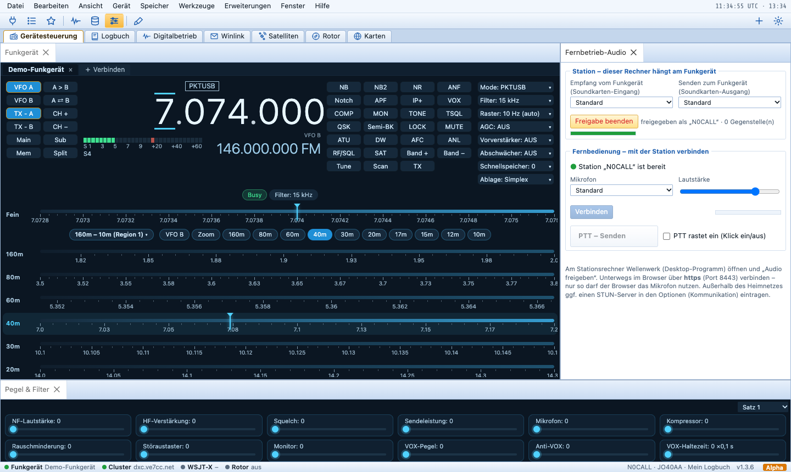

Für den Betrieb aus einem anderen Raum oder unterwegs: **Ansicht → Fernbetrieb-Audio**.

1. **Am Stationsrechner** (dort, wo die Soundkarte am Funkgerät hängt): **Empfang vom Funkgerät** und **Senden zum Funkgerät** wählen, **Audio freigeben**.
2. **Am anderen Rechner/Tablet** Wellenwerk im Browser öffnen – wegen des Mikrofons über **https** (Port 8443), im Heimnetz z. B. `https://stationsrechner:8443` – und **Verbinden**. Der Empfang ist sofort zu hören.
3. **PTT – Senden** gedrückt halten (oder „rastet ein“ wählen): das Funkgerät sendet, das Mikrofon geht zur Station. Loslassen = Empfang.

Das Audio läuft direkt zwischen den Rechnern (WebRTC, Opus); außerhalb des Heimnetzes in den Optionen (**Kommunikation**) einen STUN-Server eintragen.

## 5. Fenster anordnen und Layouts

**Bildschirmgröße:** Wellenwerk passt sich der Auflösung an – vom Laptop (auch 4:3, ab etwa 1024 × 660 Bildpunkten im Browser) bis 4K:
- Auf niedrigen oder schmalen Bildschirmen werden Kopfzeilen kompakter; Werkzeugleisten, die nicht in eine Zeile passen, zeigen nur Symbole (Beschriftung beim Darüberfahren).
- Die Geräteanzeige verkleinert sich bei Bedarf, statt Scrollbalken zu zeigen; Klicks auf Skalen und Ziffern treffen weiterhin genau.
- Wird der **Wasserfall** geöffnet, wandert die Geräteanzeige schmal an die linke Seite – Frequenz, S-Meter und Tasten untereinander, wie bei SDR-Console – und der Wasserfall bekommt die Breite. Beim Schließen des Wasserfalls springt die vorherige Anordnung zurück. Abschaltbar unter **F8 → Wasserfall**.
- Auf sehr großen Bildschirmen ohne Systemskalierung (z. B. 4K bei 100 %) vergrößert Wellenwerk die Oberfläche automatisch; die Größe lässt sich unter **F8 → Darstellung → Größe der Oberfläche** auch fest einstellen (80–200 %).

Jeder Bereich ist ein eigenes Fenster, das sich frei anordnen lässt:

- **Verschieben:** am Reiter (Titel) ziehen und an einer Kante oder in der Mitte eines anderen Fensters ablegen (dann als Reiter).
- **Größe:** an den Trennlinien ziehen.
- **Lösen:** Taste ⇱ rechts im Fensterkopf – das Fenster schwebt frei (im Bild oben: „Auswahl“).
- **Auf einen zweiten Bildschirm:** Taste ⧉ – das Fenster wird zu einem eigenen Programmfenster.
- **Maximieren:** Taste □.
- **Fenster-Menü:** Nebeneinander anordnen, Alle Fenster andocken, Standardanordnung wiederherstellen, **Layout A/B** speichern und laden, Vollbild (**F11**).

Die Anordnung wird je Bereich (Gerätesteuerung, Logbuch, Digitalbetrieb …) automatisch gespeichert.

## 6. Rechtsklick-Menüs

Fast jedes Element hat ein Rechtsklick-Menü mit den passenden Befehlen – zum Beispiel die Frequenzanzeige:

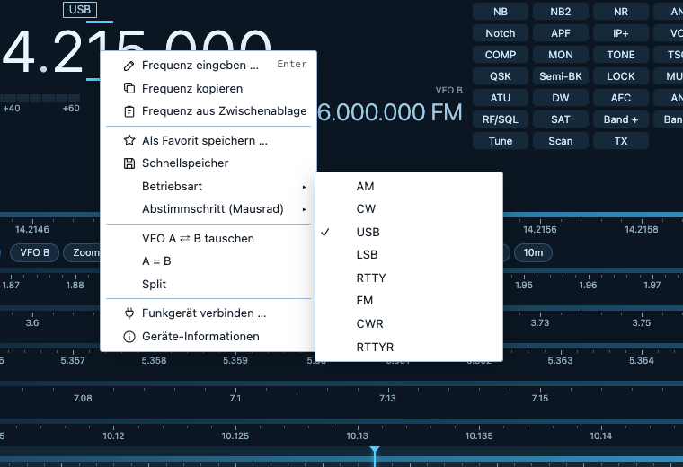

Eine Auswahl:

| Rechtsklick auf … | Befehle |
|---|---|
| Frequenzanzeige | Frequenz eingeben/kopieren/einfügen, als Favorit, Schnellspeicher, Betriebsart, Abstimmschritt, VFO-Befehle, Split |
| Funktionstaste | Auslösen, verschieben, ausblenden, Layout anpassen |
| Bandtaste | Band wählen, gemerkte Frequenz vergessen, Spreizung, Bandplan |
| Abstimmleiste | Hier abstimmen, Favorit, Schnellspeicher-Marken löschen; auf einem Spot: alle Rufzeichen-Befehle |
| Regler | Minimum / Mitte / Maximum, Regler-Layout |
| Favorit / Ordner | Abstimmen, umbenennen, verschieben, löschen |
| Logbuch-Zeile | Bearbeiten, löschen, kopieren, ADIF, QSL, Hochladen, auf QSO-Frequenz abstimmen, Filtern, Antenne drehen, Spot senden |
| Logbuch-Spaltenkopf | Sortieren, Spalten ein-/ausblenden |
| Cluster-Spot, FT8-Decode, Bandkarte | Abstimmen, Logbuch-Eintrag, Nachschlagen, Antenne drehen (kurzer/langer Weg), QRZ.com, Spot senden, Alarm |
| Karte | Locator und Richtung des Punktes, Antenne dorthin drehen, Locator kopieren |
| Rotor | Auf Grad drehen, Stopp, Parken, Himmelsrichtungen |
| Wasserfall | Hier empfangen, Frequenz kopieren, Betriebsart, AFC |
| Wort im Empfangstext | als Rufzeichen/Name/QTH/Locator/RST ins QSO, Nachschlagen |
| Sendefeld | Senden, Makro oder Platzhalter einfügen, Ausschneiden/Kopieren/Einfügen |
| Fensterreiter | Lösen, eigenes Fenster, maximieren, schließen, anordnen |
| Eingabefelder | Ausschneiden, Kopieren, Einfügen, Alles markieren |

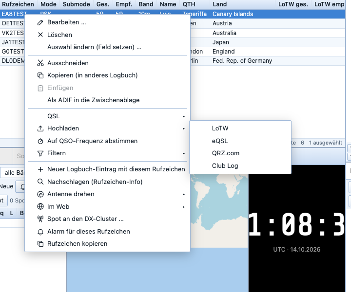

## 7. Logbuch

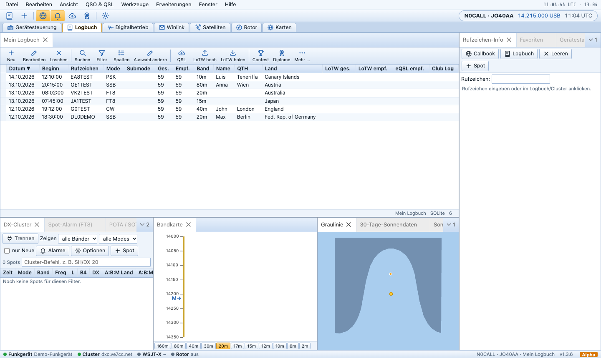

- **Mitte:** das Logbuch mit Werkzeugleiste (Neu, Contest, Löschen, Ansehen, Ausschneiden/Kopieren/Einfügen, Aktualisieren, Spalten, Auswahl ändern, Suchen, Filter, QSL, LoTW, Sicherung …). Spalten per Ziehen am Kopf verbreitern, Klick auf den Kopf sortiert.
- **Links:** Rufzeichen-Info (Callbook mit Foto, Name, Adresse; Matrix „gearbeitet/bestätigt“ je Band und Betriebsart für Rufzeichen und Land), Favoriten, Funkgerät-Feld.
- **Rechts:** Bandkarte mit Spots, Graulinie, Uhr, Rotor.
- **Unten:** Sonnendaten, Sonnenzyklus, Audio-Monitor, DX-Cluster, Alert (FT8), DX-Histogramm, Kalender (Contests und DXpeditionen), Audio-Rekorder, Netzwerk.

**QSO eintragen:** **Neu** (oder **Eintrag** in der Werkzeugleiste). Rufzeichen eintippen – Land, Entfernung, Richtung, frühere QSOs und Callbook-Daten erscheinen sofort. Frequenz, Band und Betriebsart kommen vom Funkgerät. **Enter** speichert, **Esc** leert.

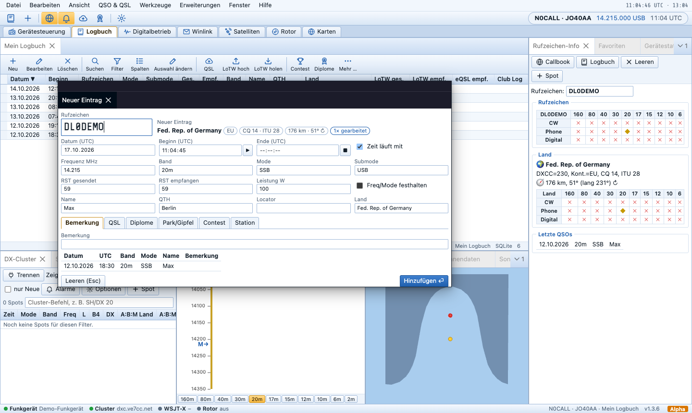

**Mehrere Logbücher:** **Mehr … → Logbuch-Verwaltung**: anlegen, umbenennen, sichern, wiederherstellen. QSOs lassen sich per Ausschneiden/Kopieren und Einfügen zwischen Logbüchern verschieben.

**Import/Export:** **Mehr … → ADIF importieren/exportieren**, Cabrillo-Export, Logbuch drucken, QSL-Etiketten drucken.

**Contest-Modus:** Taste **Contest** – fortlaufende Nummern werden automatisch vergeben.

**Diplome:** **Diplome** zeigt DXCC, DXCC-Challenge, WAZ, WAS, WAC, WPX, ITU-Zonen, Europa, DOK, IOTA, VUCC-Locatorfelder, US-Counties und den CQ DX Marathon – wahlweise gearbeitet oder bestätigt.

**Suchen, Filter und gespeicherte Ansichten:** **Suchen** blendet die Filterleiste ein (Text, Band, Mode, QSL-Status, Zeitraum). Im Feld **Bedingung** lassen sich beliebige Felder abfragen, mehrere mit `;` getrennt: `=`, `!=`, `<`, `>`, `<=`, `>=`, `~` (enthält), `!~` (enthält nicht), `leer`, `nicht leer` – z. B. `cqz=14; iota nicht leer` oder `band=20m; country~Japan; qso_date>=20260101`. **Ansicht … → Aktuelle Ansicht speichern** merkt sich Filter, Spalten und Sortierung unter einem Namen.

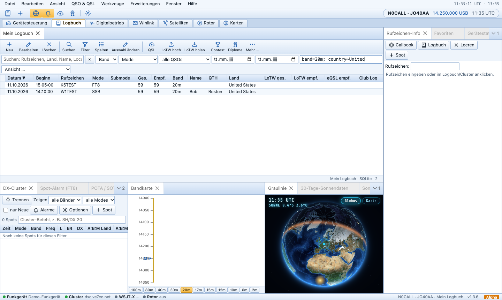

**Betriebsarten und RST:** **F8 → Betriebsarten** – eine Zeile je Mode mit RST-Vorgabe (z. B. `FT8 -10`, `CW 599`). Die Liste erscheint im Feld Mode des Eintrags, beim Wechsel der Betriebsart werden die RST-Felder vorbelegt.

**POTA, SOTA und WWFF:** Fenster **POTA / SOTA / WWFF** im Logbuch (Menü **Extras**) zeigt aktuelle Spots (Klick stimmt ab, Doppelklick öffnet den Eintrag mit Referenz), im Eintrag gibt es eine Referenzsuche. Für eigene Aktivierungen **Stationsprofile** anlegen (Rufzeichen, Locator, eigene Park-/Gipfel-Referenz) – der Zähler zeigt die QSOs des Tages, **Selbst-Spot** meldet die Aktivierung, **Export** erzeugt die Logdatei fürs Portal.

**Andere Programme anbinden** (**F8 → Programme & Sicherung**):
- **QSOs weiterleiten** an andere Programme (UDP; ADIF, WSJT-X „Logged ADIF“ für GridTracker/Log4OM oder N1MM-Format).
- **Empfangen:** N1MM Logger+ (Contacts), **ADIF per UDP** – z. B. von **VarAC**, **JTAlert** oder **GridTracker** – sowie WSJT-X/JTDX. Doppelte QSOs werden erkannt.
- **WSJT-X-Pakete weiterreichen** an GridTracker oder JTAlert.

**Weitere Werkzeuge** unter **Mehr …**: Google-Earth-Datei (KML), Datenbank prüfen und optimieren, Callbook für die Auswahl abfragen (leere Felder füllen), Adressetiketten drucken. **Automatische tägliche Sicherung** in einen Ordner, z. B. einen Cloud-Ordner.

## 8. DX-Cluster, Alarme und WSJT-X

- **DX-Cluster:** Server in den Optionen eintragen. Spots werden markiert: **rot = neues Land**, **orange = neues Band**, grau = schon gearbeitet. Klick stimmt Funkgerät und Betriebsart ab. **Alarme** meldet neue Länder/Bänder oder bestimmte Rufzeichen (mit Ton). **Spot** sendet einen eigenen Spot.
- **WSJT-X / JTDX:** In WSJT-X unter *Einstellungen → Berichte* „UDP-Server“ auf `127.0.0.1` und Port `2237` stellen, Haken bei „Akzeptiere UDP-Anfragen“. Geloggte QSOs landen automatisch im Logbuch. Das Fenster **Alert (FT8)** zeigt alle Decodes mit Land und Status; **Doppelklick** ruft die Station in WSJT-X an, **TX stopp** beendet das Senden.

## 9. Online-Dienste

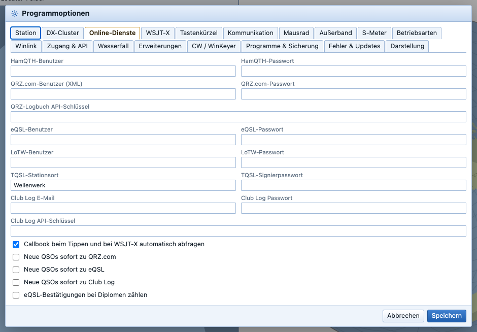

In den Optionen unter **Online-Dienste**:

- **Callbook:** HamQTH (kostenlos) und/oder QRZ.com (XML-Abo) – liefern Name, QTH, Locator, Foto beim Tippen des Rufzeichens.
- **QRZ.com-Logbuch:** API-Schlüssel aus dem QRZ-Logbuch.
- **eQSL:** Benutzername und Passwort.
- **LoTW:** Zugangsdaten für den Abgleich und das **.p12-Zertifikat** (aus TQSL exportieren) mit Passwort für den Upload.
- **Club Log:** E-Mail, Passwort, Rufzeichen.

Neue QSOs können automatisch hochgeladen werden (Haken „Neue QSOs sofort …“). Bestätigungen holt **LoTW holen** (Werkzeugleiste des Logbuchs) bzw. der Bereich **QSL & Online** ab.

## 10. Digitalbetrieb

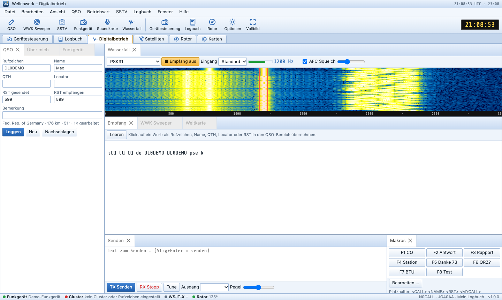

**Einrichten:** Funkgerät-Audio mit dem Rechner verbinden (USB-Soundkarte im Funkgerät oder Interface). Im **Wasserfall** den **Eingang** wählen und **Empfang** einschalten, im Fenster **Senden** den **Ausgang** und den **Pegel** (so einstellen, dass die ALC des Funkgeräts nicht ausschlägt). Funkgerät auf USB bzw. die Daten-Betriebsart (USB-D/PKTUSB) stellen.

**Betriebsarten** (Auswahl oben links im Wasserfall oder Menü **Betriebsart**):

| Gruppe | Varianten |
|---|---|
| PSK | BPSK31/63/125, QPSK31/63/125 |
| RTTY | 45,45 Baud / 170 Hz (Amateurfunk); einstellbar 50, 75, 100 Baud und 200, 425, 450, 850 Hz Shift – z. B. Wetterdienst DWD: 50 Baud, 450 Hz, Lage „umgekehrt“ oder „automatisch“, USOS aus |
| CW | über Funkgerät oder WinKeyer |
| MFSK | MFSK8, MFSK16, MFSK32 |
| DominoEX, THOR | 4, 5, 8, 11, 16, 22 |
| Olivia, Contestia | 4/125 … 64/2000 |
| Throb | 1, 2, 4 |
| MT63 | 500, 1000, 2000 Hz, kurzes und langes Interleave |
| Hellschreiben | Feld-Hell (Bildanzeige statt Text) |
| SSTV | siehe [Kapitel 11](#11-sstv-bildübertragung) |

**Bedienung:**
- **Klick in den Wasserfall** stellt die Empfangsfrequenz auf das Signal (die Mitte wird automatisch gesucht).
- Der **Empfangstext** läuft im Fenster **Empfang**. **Klick auf ein Wort** übernimmt es als Rufzeichen, Name, QTH, Locator oder RST ins QSO-Fenster.
- **Senden:** Text eintippen, **Strg+Enter** oder **TX Senden**. PTT wird automatisch geschaltet. **RX Stopp** bricht ab, **Tune** sendet 4 s Dauerton.
- **Makros F1–F12** mit Platzhaltern wie `<CALL>`, `<NAME>`, `<RST>`, `<MYCALL>`, `<MYQTH>`, `<MYLOC>`, `<TIME>` – **Bearbeiten …** zum Ändern. Die eigenen Angaben stehen unter **Über mich**.
- **QSO-Fenster:** Rufzeichen, Name, RST … sammeln und **Loggen** – Betriebsart und Frequenz werden automatisch eingetragen.
- **WWK Sweeper:** dekodiert bis zu 16 Signale gleichzeitig (BPSK, RTTY oder CW); Klick übernimmt ein Signal in den Haupt-Dekoder.
- **Weltkarte:** zeigt die gehörten Stationen.

### FreeDV (digitale Sprache)

**Ansicht → FreeDV (digitale Sprache)** im Digitalbetrieb. Modus wählen (**700D**, **700E** oder **1600** – auf den FreeDV-Frequenzen meist 700D/700E), **Empfang von** (Soundkarte des Funkgeräts oder ein Empfänger/WebSDR), **Lautsprecher**, **Mikrofon** und **Senden zum Funkgerät** einstellen, **▶ Empfang**. Grün = synchronisiert, daneben der Störabstand. Zum Sprechen **PTT** gedrückt halten (oder „rastet ein“). Das Funkgerät steht dabei auf USB.

## 11. SSTV (Bildübertragung)

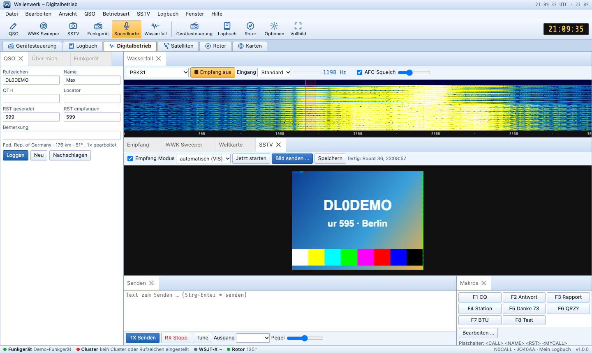

**SSTV-Fenster** über die Werkzeugleiste (**SSTV**) oder das Menü **SSTV**.

- **Empfang** einschalten. Der Modus wird am Bildanfang (VIS-Kennung) automatisch erkannt; Schräglauf durch ungenaue Soundkarten wird ausgeglichen. Läuft ein Bild schon, Modus wählen und **Jetzt starten**.
- Empfangene Bilder werden automatisch in **SSTV-Bilder** (Galerie) gespeichert.
- 18 Modi: Martin M1/M2, Scottie S1/S2/DX, Robot 36/72, PD 50/90/120/160/180/240/290, Wraase SC2-180, Pasokon P3/P5/P7.

**Senden:** **Bild senden …**

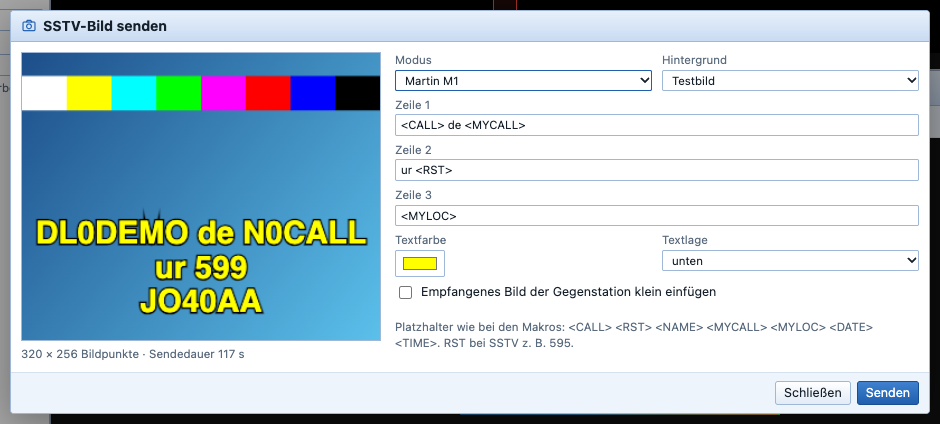

Hintergrund wählen (Testbild, eigene Bilddatei, zuletzt empfangenes Bild), bis zu drei Textzeilen mit Platzhaltern (`<CALL> de <MYCALL>`, `ur <RST>` …), Textfarbe und -lage. Mit **Empfangenes Bild der Gegenstation klein einfügen** sieht die Gegenstation, wie ihr Bild angekommen ist. Die Vorschau zeigt das Ergebnis und die Sendedauer.

## 12. Winlink (E-Mail über Funk)

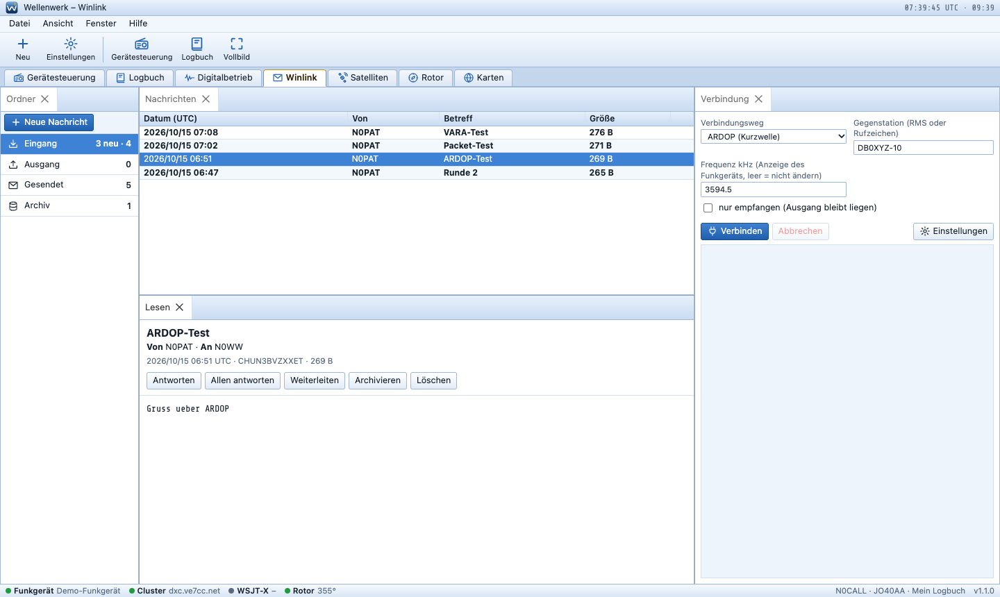

Das Register **Winlink** ist ein vollständiges Winlink-Postfach: Nachrichten schreiben, über Funk oder Internet austauschen, lesen, beantworten. Links die Ordner (**Posteingang**, **Postausgang**, **Gesendet**, **Archiv**), in der Mitte die Nachrichten und darunter das Lesefenster, rechts die Verbindung mit Protokoll.

**Einrichten** (**Einstellungen** bzw. **F8 → Winlink**): Winlink-Rufzeichen (leer = Stationsrufzeichen) und **Winlink-Passwort** des Kontos auf winlink.org. Für Funkbetrieb zusätzlich das Modem:

| Verbindungsweg | Was gebraucht wird |
|---|---|
| **Telnet – Winlink-Server** | nur Internet (Austausch direkt mit dem Winlink-Server, z. B. zum Testen) |
| **Telnet – Peer** | Adresse und Port einer anderen Station im Netz (Station-zu-Station ohne Server) |
| **ARDOP** (Kurzwelle) | das freie Modem **ardopcf** läuft auf diesem Rechner, z. B. `ardopcf 8515 <Soundkarte> <Soundkarte>` |
| **VARA** | das Programm **VARA** (eigenständig, eigene Lizenz) läuft; Wellenwerk nutzt nur seine TCP-Schnittstelle (Port 8300) |
| **Packet** (VHF/UHF) | **Direwolf** (oder ein anderes Modem mit AGW-Schnittstelle) läuft, AGW-Port 8000 |

Bei ARDOP und VARA tastet Wellenwerk das Funkgerät, sobald das Modem senden will (oder das Modem macht es selbst bzw. per VOX – Einstellung **PTT**).

**Nachricht schreiben:** **Neu** – Empfänger (Rufzeichen oder E-Mail-Adresse, mehrere mit Komma), Betreff, Text, Anhänge. Die Nachricht wartet im **Ausgang** auf die nächste Verbindung. Über Funk Anhänge klein halten.

**Verbinden:** Verbindungsweg wählen, bei Funk die **Gegenstation** (Rufzeichen des RMS-Gateways bzw. der Station) und optional die **Frequenz** in kHz eintragen – das Funkgerät wird vorher darauf gestellt. **Verbinden** tauscht in beide Richtungen aus: Ausgang wird gesendet, neue Nachrichten landen im Eingang (fett = ungelesen). **Nur empfangen** lässt den Ausgang liegen. Das Protokoll zeigt jeden Schritt.

**Lesen und weiter:** Klick auf eine Nachricht zeigt sie unten an; Knöpfe bzw. Rechtsklick: **Antworten**, **Allen antworten**, **Weiterleiten**, **Archivieren**, **Löschen**, im Ordner Gesendet **Erneut senden**. Anhänge per Klick speichern.

**Chat (Tastatur-QSO):** Im Register Winlink das Fenster **Chat** öffnen. Verbindungsweg (ARDOP, VARA, Packet oder Telnet zu `host:port`) und Gegenstation wählen, **Anrufen** – oder **Auf Anrufe warten**, dann nimmt Wellenwerk eingehende Verbindungen an (und wartet danach weiter). Text eintippen, Enter sendet. **Loggen** übernimmt die Gegenstation ins Logbuch. Gesendet wird reiner Text zeilenweise; das passt zu einfachen Terminal-Programmen. Chat und Winlink teilen sich das Modem – es geht immer nur eins.

> Die Nachrichten liegen als Dateien im Datenordner unter `winlink/` (ein Ordner je Postfach-Ordner) und sind damit Teil der Sicherung.

## 13. Satelliten

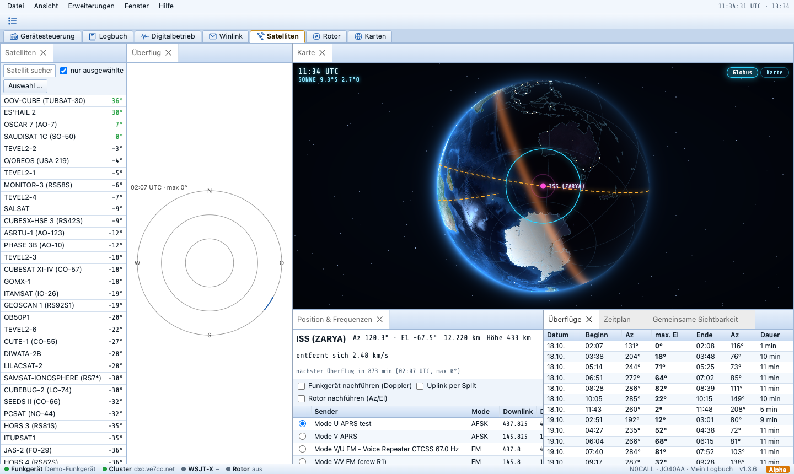

Bahndaten und Sender werden automatisch geladen. Links die Liste mit aktueller Elevation (über dem Horizont grün), **Auswahl …** legt bis zu 100 Satelliten fest. Daneben das Überflug-Polardiagramm, die Karte mit Bodenspur und Sichtbereich, Position und Frequenzen sowie die nächsten Überflüge.

- **Sender** des Satelliten wählen – Downlink/Uplink werden angezeigt.
- **Funkgerät nachführen (Doppler):** stellt die Empfangsfrequenz laufend nach; **Uplink per Split** stellt die Sendefrequenz mit ein.
- **Rotor nachführen (Az/El):** dreht die Antenne mit.
- **Zeitplan:** alle ausgewählten Satelliten der nächsten Stunden nach Beginn sortiert, mit Mindest-Elevation und Filter „nur mit Sprechfunk/Transponder“. Klick wählt den Satelliten.
- **Gemeinsame Sichtbarkeit:** Rufzeichen oder Locator der Gegenstation eingeben – die Liste zeigt, wann ein Satellit für **beide** Stationen über dem Horizont steht (für einen oder alle ausgewählten Satelliten).

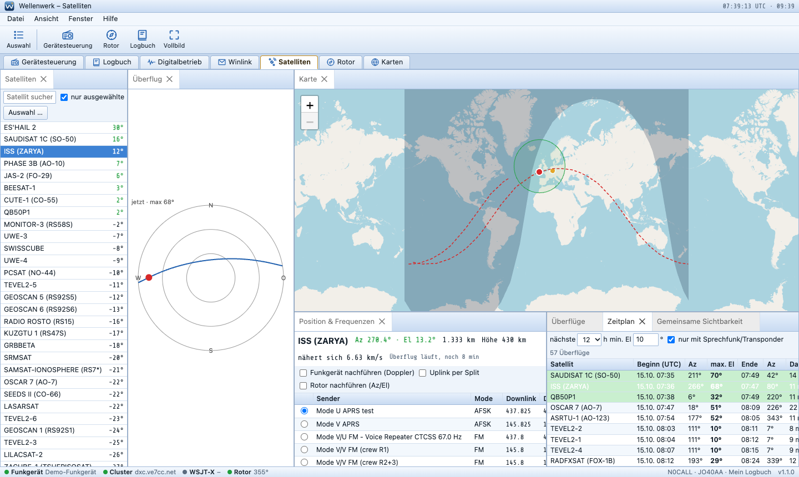

## 14. Rotor

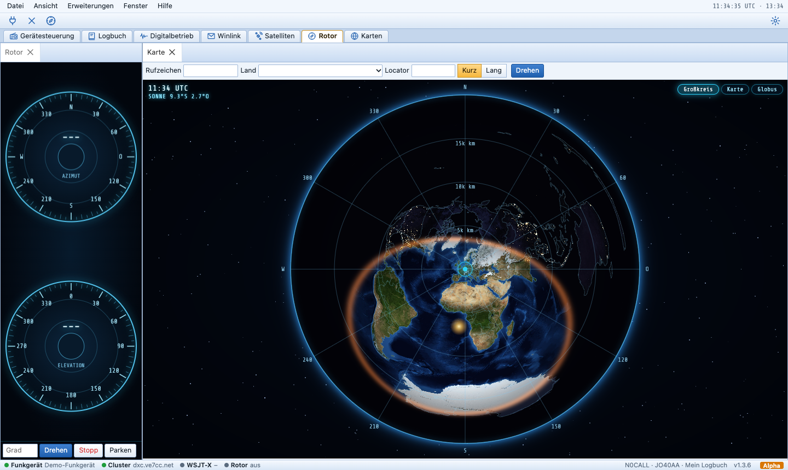

**Rotor verbinden:** Hersteller/Modell, Port und Geschwindigkeit (wie beim Funkgerät). Bedienung: Klick ins Rundinstrument dreht dorthin, Gradzahl eingeben, Stopp, Parken. Die Karte rechts zeigt die Strahlrichtung (Mercator oder Großkreis um den eigenen Standort). Ziel per **Rufzeichen, Land oder Locator** eingeben, **Kurz/Lang** für den kurzen bzw. langen Weg, dann **Rotor drehen**. Aus Logbuch, Cluster und Karten geht es per Rechtsklick → **Antenne drehen**.

Im Verbinden-Dialog außerdem: **Anschlag** im Norden (0°…360°) oder Süden (−180°…+180°), **Azimut-Versatz** zum Kalibrieren (zeigt der Rotor 10° zu viel, −10 eintragen), eigener **Drehbereich** für Rotoren mit Überlauf (z. B. 0…450° – Wellenwerk nimmt dann den kürzeren Weg) und ein **Bewegungsprotokoll**.

## 15. Karten

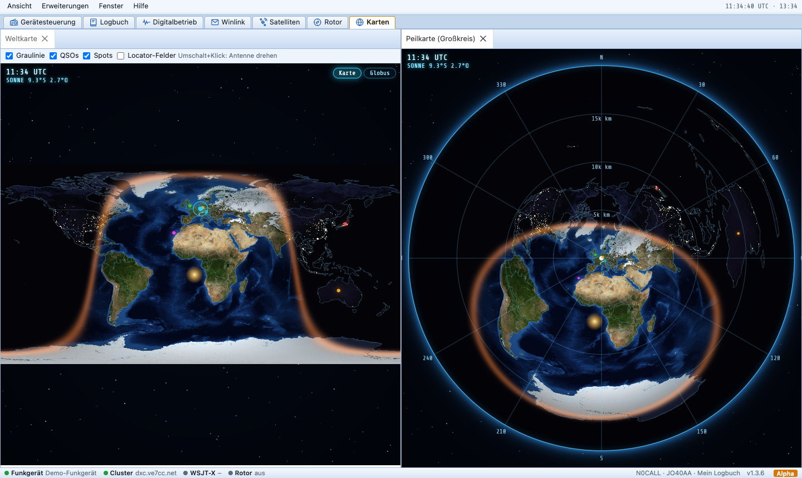

Weltkarte mit Graulinie (Tag/Nacht), eigener Station und Spots, dazu die **Peilkarte** (mittabstandstreu um den eigenen Standort – Richtungen stimmen dort exakt). Rechtsklick auf einen Punkt zeigt Locator, Richtung und Entfernung und dreht auf Wunsch die Antenne.

## 16. Tastenkürzel

| Taste | Wirkung |
|---|---|
| F8 | Programmoptionen |
| Strg+F8 | Layout anpassen |
| F11 | Vollbild |
| Mausrad über einer Ziffer | diese Stelle verstellen (auf den Leisten: Shift ×2, Strg ×5) |
| ← / → | aktive Ziffer wechseln |
| ↑ / ↓, + / − | aktive Ziffer erhöhen / verringern |
| 0–9 | Ziffer eintippen |
| Enter | Frequenzeingabe (Gerätesteuerung) bzw. QSO speichern (Eintrag) |
| Esc | Eingabe leeren, Menü schließen |
| F1–F12 | Makros im Digitalbetrieb |
| Strg+Enter | Text senden (Digitalbetrieb) |

Eigene Tastenkürzel: **Optionen → Tastenkürzel**.

## 17. Daten, Sicherung und Umzug

Alle Daten (Logbücher, Einstellungen, Favoriten, SSTV-Bilder) liegen im Benutzerordner:

- Windows: `%APPDATA%\Wellenwerk`
- macOS: `~/Library/Application Support/Wellenwerk`
- Linux: `~/.local/share/wellenwerk`

**Sichern:** **Sicherung** (Werkzeugleiste des Logbuchs) legt eine Kopie des aktuellen Logbuchs an; **Mehr … → Sicherungen** stellt wieder her. Für einen Rechnerwechsel den ganzen Ordner kopieren oder das Logbuch als ADIF exportieren und auf dem neuen Rechner importieren. Das Layout der Gerätesteuerung überträgt **Layout anpassen → Layout als Datei speichern / laden**.

## 18. Zugang, API und KI-Assistenten

Einstellungen unter **F8 → Zugang & API**.

**Passwort:** Am Rechner, auf dem Wellenwerk läuft, ist nie eine Anmeldung nötig. Ist ein Passwort gesetzt, fragt Wellenwerk bei Zugriffen von anderen Geräten (Tablet, Handy, zweiter PC – auch über `https://…:8443`) einmal danach. **Vor jedem Zugriff aus dem Internet unbedingt setzen.**

**Stationsdaten an einer Stelle:** Rufzeichen, Locator, Operator und Leistung kommen aus **Station** bzw. dem aktiven **Stationsprofil** und gelten für alle Programmteile (Logbuch, Winlink, Karten, Rotor, Satelliten …), für die Schnittstelle und für Erweiterungen. Wechselt das Profil, wissen es sofort alle.

**API:** Alles, was die Oberfläche kann, geht auch über die Schnittstelle. Die Beschreibung aller Funktionen zum Ausprobieren: **API-Dokumentation** (Adresse `/api/docs`). Programme auf anderen Rechnern brauchen einen **API-Schlüssel** (**Neuen Schlüssel erzeugen**) und schicken ihn als `Authorization: Bearer <Schlüssel>`. Ereignisse (Frequenz, Spots, QSOs, Stationsdaten …) kommen in Echtzeit über den WebSocket `/ws`.

**KI-Assistenten (MCP):** Wellenwerk bringt einen MCP-Server mit. Damit können z. B. Claude Desktop oder andere KI-Programme die Station abfragen und bedienen: Frequenz und Betriebsart, Rufzeichen nachschlagen, im Logbuch suchen, QSOs eintragen, DX-Spots, Rotor, Winlink-Nachrichten. Den fertigen Eintrag zeigt das Feld **MCP-Eintrag** – **Kopieren** und in die Konfiguration des KI-Programms einfügen (bei Claude Desktop: *Einstellungen → Entwickler → Konfiguration bearbeiten*). Wellenwerk muss dabei laufen.

**Erweiterungen:** Unter **F8 → Erweiterungen** lassen sich Erweiterungen (Plugins) installieren (ZIP), ein- und ausschalten und einstellen. Ein Beispiel liegt bei. Wie man selbst welche schreibt, steht in der [Anleitung für Entwickler](Erweiterungen.md) (im Programm: Link im selben Reiter). Erweiterungen bekommen die Stationsdaten und alle Ereignisse automatisch mit.

> **Senden** (PTT, CW, Winlink über Funk) dürfen Assistenten nur, wenn **„KI-Assistenten dürfen senden“** eingeschaltet ist. Für alles, was ausgesendet wird, bleibt die Funkamateurin bzw. der Funkamateur verantwortlich.

## 19. Fehlerbericht und Aktualisierung

**Wellenwerk ist eine experimentelle Alpha-Version** – nicht alles funktioniert schon fehlerfrei. Darauf weist ein Hinweis beim Öffnen hin (abschaltbar bis zur nächsten Version, wieder aufrufbar unter **Hilfe → Hinweis zur Alpha-Version**). Jeder Nutzer hilft, das Programm zu verbessern, indem er es testet und Probleme meldet.

**Feedback / Problem melden** (Menü **Hilfe** oder das orange **Alpha**-Zeichen unten rechts): Art wählen, das Problem mit eigenen Worten beschreiben, auf Wunsch Fehlerprotokoll und Systemdaten anhängen (keine Passwörter). **Abschicken** sendet die Meldung per E-Mail an die unter *Fehler & Updates* eingetragene Adresse; **Auf GitHub melden** öffnet eine vorausgefüllte Meldung im öffentlichen Projekt (GitHub-Konto nötig).

**F8 → Fehler & Updates.**

**Anonyme Nutzerzählung:** Ein laufendes Wellenwerk meldet sich alle 10 Minuten bei der Annahmestelle der Entwickler. Daraus entsteht die Anzeige „Wellenwerk online“ (Zahl der Nutzer und Länder) auf der Seite des Entwicklers. Übertragen werden nur eine zufällige Programm-Nummer (Datei `instanz-id` im Datenordner) und die Versionsnummer. Das Land ermittelt der Empfangsdienst (Cloudflare) aus der Verbindung. Gespeichert werden weder IP-Adresse noch Rufzeichen oder Standort; nach 25 Minuten ohne Meldung verschwindet der Eintrag, beim Beenden sofort. Abschalten: Haken *Anonym als „online“ mitzählen lassen* entfernen.

**Fehlerbericht per E-Mail:** Wellenwerk sammelt Programmfehler aus Dienst, Oberfläche und Desktop-Programm im **Fehlerprotokoll** (**Hilfe → Fehlerprotokoll**). Mit *Fehler automatisch per E-Mail melden* geht etwa eine Minute nach einem Fehler eine Nachricht an die eingetragene Adresse – höchstens eine je eingestelltem Zeitraum (Vorgabe 30 Minuten) und höchstens 20 am Tag. Gleiche Fehler werden zusammengefasst, Passwörter und Schlüssel unkenntlich gemacht. Für den Versand ein E-Mail-Konto eintragen (SMTP-Server, Port, Benutzername, Passwort – z. B. bei freenet `mx.freenet.de`, Port 587, STARTTLS). Ohne Konto versucht Wellenwerk, die Nachricht direkt zuzustellen; das lehnen viele Anbieter ab. **Testnachricht senden** prüft die Einstellungen.

**Aktualisierung:** Bei jedem Start sieht Wellenwerk nach, ob es auf GitHub eine neuere Version gibt.

| Einstellung | Verhalten |
|---|---|
| beim Start automatisch installieren (Vorgabe) | Desktop-Programm: lädt das passende Paket (mit Prüfsumme), installiert es und startet neu – ein kleines Fenster zeigt den Fortschritt, **Überspringen** startet die bisherige Version. Server (Linux, aus dem Quellcode): tauscht die Programmdateien aus, installiert geänderte Python-Pakete und startet neu; der alte Stand liegt als Sicherung in `data/update/`. |
| nur melden | Hinweis in der Oberfläche; installieren über **Hilfe → Nach Updates suchen**. |
| nicht prüfen | keine Abfrage |

Was neu ist oder behoben wurde, zeigt das Fortschrittsfenster schon während des Ladens; beim ersten Start der neuen Version erscheint es noch einmal als Hinweis (jederzeit wieder: **Hilfe → Neuerungen dieser Version**). Ein Server, der dauerhaft läuft, prüft zusätzlich einmal am Tag. Während gesendet wird, installiert Wellenwerk nicht. Unter macOS braucht das Programm Schreibrecht im Programme-Ordner; sonst öffnet Wellenwerk das neue Installationsabbild zum Hineinziehen. Unter Linux wird ein .deb-Paket mit `pkexec` (Passwortabfrage) installiert, ein AppImage einfach ersetzt.

## 20. Probleme lösen

| Problem | Lösung |
|---|---|
| „Funkgerät antwortet nicht“ | COM-Port und Baudrate prüfen (**Baudrate suchen**), bei Icom die CI-V-Adresse. Kein anderes Programm darf denselben COM-Port belegen – andere Programme stattdessen über „Für andere Programme“ (Hamlib NET rigctl) anbinden. |
| Kein COM-Port in der Liste | USB-Treiber des Funkgeräts installieren, Kabel neu stecken, Dialog neu öffnen. Linux: Gruppe `dialout`. |
| Kein Ton im Digitalbetrieb | Richtigen **Eingang** wählen; macOS: Mikrofonzugriff für Wellenwerk erlauben (*Systemeinstellungen → Datenschutz → Mikrofon*). |
| Sendesignal verzerrt | **Pegel** verringern, Funkgerät-ALC beobachten, Sprachprozessor aus. |
| PTT schaltet nicht | Im Verbinden-Dialog **PTT über** prüfen (CAT, DTR oder RTS). |
| Panadapter bleibt leer | Icom: Scope im Gerät einschalten, „CI-V USB Port“ auf Unlinked, 115200 Baud, Haken „Panadapter“ im Verbinden-Dialog. IQ: richtigen Stereo-Eingang wählen. |
| WSJT-X-QSOs kommen nicht an | In WSJT-X UDP-Server `127.0.0.1`, Port 2237; die Statuszeile unten zeigt „WSJT-X“ grün, sobald Daten ankommen. |
| Cluster verbindet nicht | Rufzeichen in den Optionen eintragen; anderen Server probieren. |
| Etwas funktioniert nicht wie erwartet | **Hilfe → Fehlerprotokoll** ansehen; **Herunterladen** speichert es als Textdatei zum Weitergeben. |

Die Statuszeile unten zeigt jederzeit Funkgerät, Cluster, WSJT-X und Rotor – ein Rechtsklick darauf öffnet die passenden Einstellungen.
