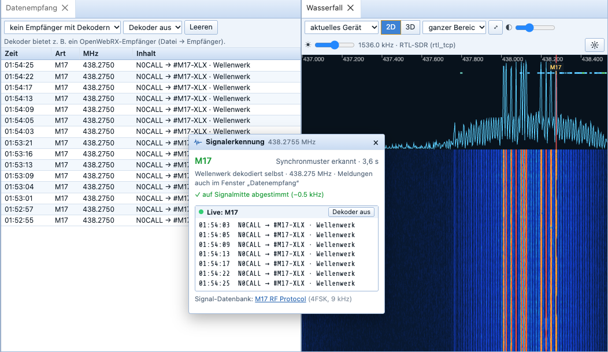
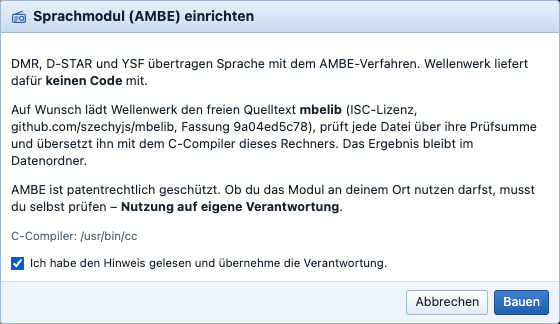

# Wellenwerk – Manual

Wellenwerk is a program for the radio station: radio control, logbook, digital modes (PSK, RTTY, Olivia, MT63, SSTV and more), Winlink e-mail over radio, satellites, rotator and maps – all in one window.

*Deutsche Anleitung: [Anleitung.md](Anleitung.md)*

> **License and liability:** Wellenwerk is free software under the GNU General Public License 3 and is provided **without any warranty**. Use – especially controlling transmitters, radios and rotators – is at your own risk. The operator is responsible for complying with amateur radio regulations. Details and all third-party licenses: [LIZENZEN.md](../LIZENZEN.md) or in the program under **Help → Licenses and third-party components**.

**Language:** Wellenwerk shows its interface in German or English. Switch under **Options (F8) → Appearance → Sprache / Language**. A new browser follows the language of the station until a language is chosen there.

**Contents**
1. [Installation](#1-installation)
2. [First start](#2-first-start)
3. [Connecting a radio](#3-connecting-a-radio)
4. [Radio control](#4-radio-control)
5. [Arranging windows and layouts](#5-arranging-windows-and-layouts)
6. [Right-click menus](#6-right-click-menus)
7. [Logbook](#7-logbook)
8. [DX cluster, alerts and WSJT-X](#8-dx-cluster-alerts-and-wsjt-x)
9. [Online services (QRZ.com, LoTW, eQSL, Club Log)](#9-online-services)
10. [Digital modes](#10-digital-modes)
11. [SSTV (picture transmission)](#11-sstv-picture-transmission)
12. [Winlink (e-mail over radio)](#12-winlink-e-mail-over-radio)
13. [Satellites](#13-satellites)
14. [Rotator](#14-rotator)
15. [Maps](#15-maps)
16. [Keyboard shortcuts](#16-keyboard-shortcuts)
17. [Data, backup and moving](#17-data-backup-and-moving)
18. [Access, API and AI assistants](#18-access-api-and-ai-assistants)
19. [Error reports and updates](#19-error-reports-and-updates)
20. [Troubleshooting](#20-troubleshooting)

The screenshots show the German interface; the English one is laid out identically.

---

## 1. Installation

The installation files are available under **Releases** in this repository.

| System | File | Note |
|---|---|---|
| Windows 10/11 | `Wellenwerk-x.y.z-Windows-Setup.exe` | Windows warns on first start (“Unknown publisher”): **More info → Run anyway**. |
| Mac with Apple chip (M1–M4) | `Wellenwerk-x.y.z-Mac-AppleSilicon.dmg` | Open the DMG, drag Wellenwerk into “Applications”. First start: **right-click → Open**. |
| Mac with Intel chip | `Wellenwerk-x.y.z-Mac-Intel.dmg` | as above |
| Linux | `.AppImage` or `.deb` | Make the AppImage executable (`chmod +x`) and start it. Add the user to the `dialout` group (`sudo usermod -aG dialout $USER`, then log in again). |

Nothing else is needed for control – radio/rotator control (Hamlib) is built in. If necessary install the **USB driver of the radio** (e.g. Silicon Labs CP210x for Icom and Yaesu, FTDI for some Kenwood/Elecraft).

## 2. First start

On the first start the **program options** open. Enter at least your **callsign** and **locator** – they are needed for distances, directions, macros, the DX cluster and logbook uploads.


The options can be opened at any time with **F8** or via **Options** (gear icon on the right of the toolbar). Important tabs:

- **Station:** callsign, locator, name/QTH for macros, **DMR ID** (for digital voice; Wellenwerk checks in the RadioID list that it belongs to your callsign)
- **DX cluster:** server (e.g. `dxc.ve7cc.net`, port 23) and login commands
- **Online services:** credentials for callbook and uploads (see [chapter 9](#9-online-services))
- **WSJT-X:** UDP port (default 2237)
- **Communication:** how often the radio is polled
- **CW / WinKeyer:** CW via the radio or a K1EL WinKeyer
- **Appearance:** colour scheme (Classic, Light, Dark, Night vision) and language

A **demo radio** is preset for trying things out – everything can be operated without a radio attached.

## 3. Connecting a radio

**File → Connect …** (or **Devices**, the plug icon on the far left of the toolbar).


1. Choose **manufacturer** and **radio** (more than 300 models).
2. Choose the **COM port**. On Windows `COM3`, `COM4` …, on the Mac `/dev/cu.usbserial-…` or `/dev/cu.SLAB_USBtoUART`, on Linux `/dev/ttyUSB0`. The **Serial ports** tab shows which port belongs to which USB device.
3. **Speed** as in the radio's menu (CAT/CI-V baud rate). Unknown? **Search baud rate** tries them all.
4. **Icom:** enter the CI-V address (e.g. IC-7300 = 94, IC-705 = A4, IC-9700 = A2). In the radio “CI-V USB Echo Back” is usually off.
5. **PTT via:** normally “CAT command”. For interfaces without CAT PTT: DTR or RTS line.
6. **Connect**. If the radio does not answer, the reason is shown in the **Status** field.

More settings:
- **Always connect on start** – for the main radio.
- **Panadapter: scope data from the radio** – for Icom radios with built-in spectrum (IC-7300/705/9700/7610 …). In the radio set “CI-V USB Port” to **Unlinked** and 115200 baud.
- **Share with other computers** – see below.
- **Frequency offset (transverter, LNB, QO-100)** – see below.

**Frequency offset for transverters and QO-100:** the collapsible **Frequency offset** section (opens automatically when an offset is set) stores an RX and a TX offset in MHz in the radio profile. Wellenwerk then shows the real frequency everywhere (radio frequency + offset) and converts back when tuning. The **TX offset** applies to the transmit frequency in split operation (VFO B); empty means “same as RX”. The **QO-100** button enters RX 9750 MHz (LNB) and TX 1968 MHz (upconverter 432 → 2400 MHz), **Transverter 2 m** 116 MHz each (28 → 144 MHz). Example QO-100 with split: receive on 10489.550 MHz (radio 739.550 MHz), transmit on 2400.050 MHz (radio 432.050 MHz). Correct the LNB offset for your own LNB's drift if needed (e.g. 9749.982). Programs sharing the radio (WSJT-X …) still see the radio frequency.


**Several radios** at once: simply connect one after the other. Each radio gets its own tab at the top of radio control.

**Sharing the radio with other programs** (WSJT-X, JTDX, N1MM, fldigi, Log4OM): on the **Saved** tab the column “For other programs” shows an address like `127.0.0.1:4600`. In the other program choose **Hamlib NET rigctl** as radio with this address. Both programs then control the same radio at the same time.

**Remote station via wfview, FLRig or another Wellenwerk station:** choose a **template** at the top of the Connect dialog. For **wfview** (Icom radios on the network/internet) switch on *Settings → External Control → Enable RigCtld* in wfview; wfview connects to the remote station, Wellenwerk controls it via port 4533. wfview provides the audio as a virtual sound card.

**Programs without a Hamlib network connection** (“serial radio” only): switch on **F8 → Communication → CAT emulation**. Wellenwerk then behaves like a **Kenwood TS-2000**. On macOS/Linux a port like `/dev/ttys003` appears (always also as `~/.wellenwerk-cat`); on Windows create a virtual port pair with **com0com**, enter one end (e.g. COM11) in Wellenwerk and the other (COM12) in the other program; alternatively a TCP port. In the other program choose “Kenwood TS-2000”, 9600 baud. Frequency, mode, PTT, S-meter, power and volume are passed to the currently selected radio.

## 4. Radio control


- **Frequency display:** the mouse wheel over a digit changes exactly that digit. Clicking a digit makes it “active” (bar); then **↑/↓** or **+/−** to change, **←/→** to move, number keys to type. **Enter** opens frequency entry.
- **Mode:** button above the frequency.
- **Left:** VFO A/B, TX A/B, A>B, A⇄B, Main/Sub, memory, channel ±. **Right:** function buttons (NB, NR, notch, ATU, tune …) and selection lists (filter, AGC, preamp, attenuator …). Which buttons appear depends on what the radio can do.
- **State:** below the display small tags show only what is currently active (e.g. Busy, Split, RIT, Lock); when transmitting power, SWR and ALC.
- **Fine scale** (“Fine”): the scale below the display; drag or use the mouse wheel (Shift = double, Ctrl = five times). The needle shows the tuned frequency.
- **Band row:** on the left the **band plan** (region 1/2/3), **VFO B** tunes the second VFO, **Zoom** spreads one band over several rows, the band buttons jump to the last used frequency and mode of the band.
- **Band scales:** one scale per band across the whole band; click or drag to tune. Cluster spots and quick memories appear as markers.
- **Levels & filters** (bottom): the radio's controls as cards; up to six **sets**, e.g. one for SSB and one for CW.
- **Bands & modes** (toolbar): favourites in folders (a click tunes), the radio's menus and all settings.
- **Remember** (toolbar): save the current frequency as a quick memory (marker on the scale) or as a favourite. Everything about storing is also in the **Memory** menu.

The toolbar is grouped by task: **Devices · Bands & modes · Remember**, then **Waterfall · Data reception · Levels & filters**, then **Interface**; on the right **Entry** (new QSO) and **Options**. Switch to the logbook, digital modes etc. with the tabs below. The menus: **Device** (VFO, split, scanner, band plan, mouse-wheel step, snapshots), **Memory** (quick memory, favourites, memory channels, macros), **Tools** (panadapter, voice keyer, remote audio, edit interface).

A closed **Radio** window comes back via **View → Radio** (**File → Connect …** reopens it as well). More windows via **View** or **Tools**: shortwave database (broadcast stations by frequency and time), band scope (sweeps a band and plots the S-meter), scanner, macros, voice keyer, **Panadapter**, **Memory channels**.

**Edit interface** (**Ctrl+F8**, toolbar **Interface**): move buttons between left and right, create your own buttons (mode, frequency, CAT command, macro), colour scheme (default is the blue Wellenwerk scheme; also Dark, LCD, Plastic blue, LCD green, Night vision), colours, size, slider sets and band plan. **Save layout as file / Load layout from file** transfers everything to other computers.


### Panadapter and memory channels


- **Panadapter** (top of the picture): spectrum and waterfall; a click tunes. Source is either the **radio scope** (Icom) or an **IQ sound card** (SDR, e.g. via DAX IQ or an IQ output). For IQ: choose the input, **Start**; if needed **IF offset** and **Swap I/Q** (if the spectrum is mirrored).
- **Memory channels** (bottom of the picture): **Read** fetches the channels from the radio. Click a channel, then **Memory → VFO** (or double-click), **VFO → memory** or **Delete**. **CSV export** saves the list.

### Snapshots and synchronizing


**Device → Snapshots …** saves the complete radio state under a name – frequency, mode and bandwidth, split with transmit frequency, RIT and all controls and switches the radio can set – and restores it with **Recall** (e.g. “40 m FT8”, “Contest SSB”). One-shot actions like starting the tuner or a tone burst are never triggered.

**Device → Couple two devices …**: a second connected radio follows the first – frequency plus an adjustable **offset** and optionally the mode (second receiver, SDR as panadapter, transverter IF).

### Receivers without a radio of your own (KiwiSDR, OpenWebRX, WebSDR)

Wellenwerk can use public internet receivers like a radio – for listening, for digital modes or as a second receiver next to your own radio. Also ideal for trying things out without a license and without a radio.

1. **File → Receivers (WebSDR/KiwiSDR) …** (or the **Receiver (SDR)** tab in the Connect dialog). The list shows more than 1800 public receivers from receiverbook.de and kiwisdr.com, sorted by distance from your station. Filters: type, search text (place, callsign, locator, antenna), **free slots**, **receives current frequency**.
2. **connect** makes the receiver the main radio; **2nd rx** connects it in addition, your own radio stays the main radio.
3. Audio, S-meter and waterfall arrive immediately; tuning, mode, volume, AGC and noise blanker work as with a radio. Transmitting is of course blocked for receivers.

When a receiver is the current radio, the display only shows the bands it can receive, and next to the radio tabs a **list with more receivers** appears (free slots, by distance) – one click switches the server; if that fails, Wellenwerk reconnects to the previous one.

**“Receivers” window** (*View*): all connected receivers with their own frequency, mode, volume, sound on/off, S-meter and a small waterfall. **follows the main radio** lets a second receiver follow the radio's frequency (e.g. to compare with a remote antenna).

**Own address and parameters:** enter a receiver directly at the bottom of the tab. Parameters separated by `;`, e.g. `password=…; span=200; freq=7074; mode=USB; user=Name` (KiwiSDR) or `profile=40m; smeter_offset=-30` (OpenWebRX).

**Digital modes:** choose **Receiver (WebSDR/KiwiSDR)** as input – PSK, RTTY, SSTV etc. then decode the receiver's audio.

**Your own SDR hardware** (bottom of the tab, “enter receiver directly”):
- **RTL-SDR stick:** start the program `rtl_tcp` (package *rtl-sdr*) and enter `127.0.0.1:1234` as address – or the parameter `start=1`, then Wellenwerk starts it itself. Shortwave without converter: `direct=2` (e.g. RTL-SDR Blog V3), with converter `offset=125000000`. With an LNB or transverter in front use `rx_offset=…` in Hz – for QO-100 with a 9750 MHz LNB `rx_offset=9750000000`, Wellenwerk then shows 10489.5 MHz. More parameters: `gain=30`, `ppm=…`, `rate=1536000`.
- **Hermes Lite 2** (and other openHPSDR devices): leave the address empty – Wellenwerk searches the network – or enter the IP. Parameters `rate=192000`, `gain=20`. Receive only in this version.

Wellenwerk computes spectrum, waterfall and audio (USB, LSB, CW, AM, FM) itself; the S-meter is not calibrated (`smeter_offset=…`).

**WebSDR.org receivers** (University of Twente and others) have no open interface: **in the browser** opens their page on the current frequency.

> The receivers are voluntary offers by radio amateurs with few slots – please disconnect after use.

### Waterfall and 3D waterfall


**View → Waterfall (2D/3D)** shows spectrum and waterfall of every source (receiver or radio scope; selectable at the top). **2D:** mouse wheel zooms, dragging pans, a click tunes, the passband is highlighted. **3D:** the latest lines as a landscape – dragging rotates, the mouse wheel changes the distance. In the **Receivers** window, too, a click into the small waterfall tunes that receiver to the clicked frequency.

In the toolbar above the waterfall:
- **Width** – displayed span from 3 kHz to 1.5 MHz or the **whole range** (⤢). The span is centred on the receive frequency and follows when you tune out of the picture. With SDR hardware (RTL-SDR, Hermes Lite 2) Wellenwerk recomputes narrow spans at finer resolution (about 12 Hz per point at 12 kHz instead of 750 Hz); with a KiwiSDR its zoom is set, with Icom radios with a scope the radio's span.
- **Contrast** (◐) and **brightness** (☀) as in SDR programs: contrast spreads the level range, brightness raises or lowers the noise floor. Double-click resets a slider. Automatic level adjustment keeps working underneath.

The waterfall scrolls at a constant speed even when a source sends its lines in bursts (KiwiSDR, OpenWebRX, internet): Wellenwerk shows the lines with a small delay and blends between them. Speed, colours, levels and 3D depth under **F8 → Waterfall**.


### SDR as panadapter for a radio without a scope

Many radios have no spectrum display of their own. If an SDR is connected as well – e.g. an **RTL-SDR** on the same antenna (via an antenna relay/TX protection or on a separate receive wire) – it takes over as the panadapter:
1. Connect the radio as usual, then add the SDR via **Connect → Receivers (SDR)** as **2nd rx**.
2. The **Waterfall** (source “current radio”) and the **Panadapter** window now show the SDR's spectrum; the toolbar says “panadapter for …”.
3. The SDR follows the radio's frequency and mode. A click in the waterfall tunes the **radio**; the radio is operated completely as usual.

The SDR is still a full receiver: switch its audio on in the **Receivers** window, and **as main radio** makes it the current device – then a click tunes the SDR itself again. The waterfall's source list also offers “… as panadapter for …” explicitly. Under **F8 → Waterfall → SDR as panadapter** the automatic mode can be switched off or a particular SDR chosen; in automatic mode radios with their own scope (Icom) keep their scope. If the radio has a frequency offset (e.g. QO-100), the SDR needs the same receive offset (`rx_offset`) to be able to follow.

Receiver audio plays with about half a second of buffer; on a stuttering internet connection the buffer grows by itself (up to 2 s). If the connection to a receiver drops, Wellenwerk reconnects by itself. After a restart or an update, the radios and receivers connected before are connected again – with the last frequency and mode.

### Tuning step

Frequencies between channels are of no use – Wellenwerk therefore tunes in the **raster of the band**. The **Step** selector on the radio shows the current step; “automatic” chooses it by band and mode:

| Range / mode | Step |
|---|---|
| Long and medium wave (AM) | 9 kHz (Region 1), 10 kHz (Region 2) |
| Shortwave broadcast bands (AM) | 5 kHz |
| CB radio | 10 kHz (channels 26.965 … 27.405 MHz) |
| 10 m and 6 m FM | 10 kHz |
| FM broadcast | 50 kHz |
| Airband (AM) | 8.33 kHz |
| 2 m FM, Freenet, marine, 23 cm | 12.5 kHz |
| 70 cm FM (also DMR/D-STAR), PMR446 | 6.25 kHz |
| SSB | 100 Hz |
| CW, digital modes | 10 Hz |

Any step from 10 Hz to 100 kHz can also be set by hand. A **click in the waterfall** snaps to the raster (signal identification also puts its measured frequency on the raster, AM broadcast e.g. on 5 kHz), **Page Up/Page Down** move one step, and the mouse wheel on the tuning scale jumps from channel to channel in channel rasters.

### Markers in the waterfall: typical frequencies, broadcast, repeaters


Below the frequency scale the waterfall shows what to expect where – a click on a marker sets frequency **and** mode, hovering shows details:
- **Typical frequencies** (turquoise): FT8, FT4, WSPR, JS8, PSK31, RTTY, SSTV, FreeDV, QRP and emergency centres of activity, calling frequencies, APRS, ISS, NCDXF beacons, QO-100 beacons; plus weather and time stations (DWD RTTY and fax, NAVTEX, VOLMET, DCF77, WWV), CB, PMR446 and Freenet channels, marine 16/70, AIS, air emergency. The list is part of the program and is updated daily from the project on GitHub – additions arrive without a new version.
- **Broadcast** (yellow): stations transmitting on this frequency **now**, from the EiBi schedule (eibispace.de) with language and target area.
- **Repeaters** (green = FM, blue = digital): repeaters within a radius (default 100 km) with callsign, mode, CTCSS or DMR colour code. The centre is the **receiver's location** (OpenWebRX reports it) – with your own devices (RTL-SDR, radio) your station (locator). Sources: DARC repeater list by DL3EL (relais.dl3el.de – it also combines EchoLink, IRLP, D-STAR, Wires-X, DMR and FM-Funknetz), EchoLink directly (worldwide, with current status), BrandMeister (DMR, with last contact) and hearham.com. If a source only gives the output frequency, Wellenwerk adds the usual offset (2 m −600 kHz, 70 cm −7.6 MHz).


**Repeaters: no guessing.** A click on a repeater – or anywhere in its channel – takes the data from the database: for **DMR, D-STAR, YSF** Wellenwerk switches on the matching decoder of the OpenWebRX directly, for **FM repeaters** it also sets **offset and CTCSS tone** on a real radio. The card shows callsign, offset, tone or colour code, place, distance and source. Only frequencies that are in no list are determined by signal identification. The three kinds can be switched on and off under **F8 → Waterfall**. The lists are cached in the data folder and fetched again at most once a week.

### Signal identification by click


Which mode is that? In **USB/LSB** a click on the signal in the waterfall (window **Waterfall**, **Receivers** or the waterfall in **Digital modes**) is enough. Wellenwerk tunes so that the signal lies at 1500 Hz audio, listens for up to 15 seconds and shows in a small card what it has identified – with confidence in percent, centre, width and distance from the noise:

- **Digital modes:** RTTY (with baud and shift), SITOR-B/NAVTEX, PSK31/63/125, QPSK, CW (with speed), Hellschreiber, MFSK, Olivia/Contestia, DominoEX/THOR, MT63, ALE
- **WSJT modes:** FT8, FT4 (by their sync patterns), WSPR, JT9, JT65
- **Image and voice:** SSTV (with mode, e.g. “Martin M1”), weather fax, FreeDV, voice (also “other sideband”), AM broadcast, unmodulated carrier

Where Wellenwerk can decode by itself, it decodes on trial to confirm; readable text appears in the card. Buttons lead straight on: **Decode in Digital modes** (mode, baud/shift and audio frequency are taken over), **Open SSTV receive**, **Open FreeDV**, **Tune as LSB**, **Set AM/CW** or for FT8 **Tune to the standard frequency**. Identified signals get a label in the waterfall for 30 seconds.

**Switch automatically and read live:** after identification Wellenwerk switches AM broadcasts to AM and voice in the wrong sideband to the right sideband. For modes Wellenwerk decodes (RTTY, PSK, CW, MFSK, Olivia, Contestia, DominoEX, THOR, MT63 …) the text then continues **live in the card** – with **Stop**; the display ends by itself when you retune. Can be switched off under **F8 → Waterfall**.

**Find the signal instead of guessing:** Wellenwerk first looks for the signal in the spectrum – the occupied range nearest to the click – and analyses only that; neighbouring signals and noise in the rest of the passband are filtered out. A click beside the signal or a too-wide filter therefore hardly matter any more.

**Wellenwerk reads FT8 and FT4 itself** (decoder ft8_lib): a click anywhere into the FT8 segment is enough. Wellenwerk waits until a whole time slot (15 s, FT4 7.5 s, UTC) has been recorded, reads the messages and then shows **every time slot live** in the card – with name and place for known callsigns, e.g. “CQ DO5HOK JO41 (Holger, Harsewinkel)”. WSJT-X is not needed for this; the computer clock should be accurate (deviation below one second).

**Exact tuning:** a click is rarely spot on. After identification Wellenwerk therefore retunes by itself (note in the card, e.g. “tuned to signal centre (−240 Hz)”):
- **Data signals and CW** (RTTY, PSK, Olivia, CW …): the measured signal centre is put exactly at 1500 Hz audio.
- **SSB voice:** with USB/LSB the tuning point is not the centre of the signal but the suppressed carrier at the edge of the sideband. Wellenwerk measures where the voice starts in the audio (about 300 Hz above the carrier when tuned correctly) and tunes to the carrier. If the voice is in the wrong sideband, it switches to the right sideband and looks for the carrier at the upper edge. If the position cannot be determined reliably (radio filters cut off differently), the tuning is left unchanged.
- **AM:** to the carrier. With an SDR waterfall Wellenwerk also recognises AM from the RF spectrum (carrier with two equally strong sidebands), even when the receiver is set to USB.

**Signal database:** below the result the card lists known signals that occur on this frequency with matching modulation and width – from an extract of the *Signal Identification Wiki* ([sigidwiki.com](https://www.sigidwiki.com), about 550 entries: name, frequencies, modulation, bandwidth). A click opens the description with audio sample and waterfall picture.

**VHF/UHF: DMR, D-STAR, APRS, wireless sensors, radiosondes.** Many OpenWebRX receivers (e.g. “OpenWebRX+”) have their own decoders. Wellenwerk uses them: a click above 30 MHz measures the **centre of the signal** in the RF spectrum (the one nearest to the click – a strong neighbouring channel does not pull it away), sets the receiver to FM and exactly to that centre – onto the channel raster (6.25 kHz) if it is within the measuring accuracy – and then tries
- by frequency: **APRS** (144.800 MHz etc.), **wireless sensors** of weather stations, thermometers etc. (433.05–434.79 MHz and 868 MHz, decoded with rtl_433 on the server), **radiosondes** (400–406 MHz, if the server offers them),
- otherwise the digital voice systems **DMR, D-STAR, YSF (C4FM), M17, NXDN, P25**.

**Fast and simultaneous:** Wellenwerk analyses the signal itself – with your own devices (RTL-SDR, Hermes Lite 2 …) directly from the IQ data, with OpenWebRX and KiwiSDR from the FM audio. Within 1.5 seconds the sync patterns of all systems are searched **at once** (DMR base/mobile station and voice/data, D-STAR, YSF, P25, NXDN48/96, M17); at the same time Wellenwerk checks for analogue FM with voice or a sub-tone. The result usually comes after 2–3 seconds. With an OpenWebRX the matching decoder is then switched on directly – no more trying one after the other (a server gives each connection only one demodulator; several connections at once would occupy slots and trigger a ban). If its own detection finds nothing and the signal is not analogue, Wellenwerk tries the server's decoders one after the other as before (the most likely ones by measured width first). With your own devices Wellenwerk then reads DMR, D-STAR, YSF and M17 itself (see below); for NXDN and P25 the card shows the detected system.

If the station is not transmitting at the moment of the click (repeater idle, DMR between transmissions), Wellenwerk retunes as soon as the signal appears. While the decoder runs, it keeps following the frequency (transmitters off frequency or drifting); tuning by hand ends this. In the narrowband segments (e.g. 144.0–144.5 and 432.0–432.5 MHz, QO-100 narrowband) it works as on HF with SSB/CW identification.

**Analogue FM:** if none of the digital decoders finds anything, Wellenwerk listens to the FM audio for 6 seconds and reports **FM voice**, **FM with packet/APRS tones** or other data, a **CTCSS tone** (e.g. “CTCSS 123 Hz” – the tone needed to open a repeater), a **carrier without modulation** or **just noise**.

**Protection against bans:** OpenWebRX+ servers ban addresses for 12 hours if profiles are changed too quickly in a row (protection against robots). Wellenwerk keeps at least 10.5 seconds between two profile changes (note “profile change in … s”) and does not retry after a ban; the message then reads “the operator has banned this internet address”. If a server is full, Wellenwerk waits several minutes before the next attempt. **Shared receiver:** all listeners of an OpenWebRX share one SDR. If another user (or the server's schedule) switches to a different profile, Wellenwerk follows the new range like the web interface and says so above the spectrum – it does not switch back by itself. If the receive frequency is outside the displayed range, that is shown there as well.

The card shows the messages live – **with names**: for DMR time slot, **who is talking** (DMR ID → callsign, first name, city from the RadioID database) and **which talkgroup** (number and name, e.g. “TG 262 Deutschland”, from the BrandMeister list), for D-STAR, YSF and M17 callsigns with name, for NXDN the ID with callsign, for APRS callsign, text and position, for sensors model, temperature (in °C), humidity, wind, rain. Above the messages a status line per DMR time slot shows what is going on (idle, data, voice or the speaker) – so you can see that decoding works even without an ongoing QSO. IDs that are in no list (e.g. from networks other than BrandMeister) remain as numbers. Wellenwerk downloads the name lists (about 300,000 entries) once a week into the data folder; lookups happen only on your own computer.

**Wellenwerk reads DMR itself with your own devices** (RTL-SDR, Hermes Lite 2 …): time slot, colour code, burst type, voice header and terminator with source and target (group/individual call), preambles – each with error correction and checksum (Golay, BPTC, Reed-Solomon, CRC), then with names and talkgroup as above. The audio of an OpenWebRX is too strongly compressed for this; its own decoder is used there.

Also read by Wellenwerk itself:

- **D-STAR:** the header with your own callsign (MY), the other station (UR, usually CQCQCQ) and the repeater fields (RPT1/RPT2), checked with Viterbi and CRC. If you join in the middle of a transmission, the header comes from the “slow data”. The 20-character text message is voted across the repetitions and gets cleaner with every pass.
- **YSF (C4FM):** source, destination and down-/uplink, even when joining late (every frame carries one field), checked with Golay, Viterbi and CRC.
- **M17:** source, destination (also a reflector like “#M17-XLX” or “@ALL”), CAN, meta text and encryption. Read from the link setup frame or, when joining late, from the six LICH parts of the stream frames, with CRC.



**Listening to voice:** see [Voice module (AMBE, optional)](#voice-module-ambe-optional).

**More receiver decoders:** if an OpenWebRX+ offers them, the *Data reception* window and the card also provide **FT8, FT4, WSPR, JT65, JT9, FST4, Q65, MSK144, JS8Call** (with the name for the callsign), **PSK31/63, RTTY** (also the weather service's 50 Bd/450 Hz), **CW, NAVTEX, SITOR-B, DSC, AIS** (ships), **ADS-B/Mode S** (aircraft with ID, altitude, speed, position), **LoRa APRS, Meshtastic, MeshCom, MeshCore** and **FANET**. A click on 162 MHz (AIS), 1090 MHz (ADS-B), 433.775 MHz (LoRa APRS), 433.175 MHz (MeshCom), 869.5 MHz (Meshtastic), 156.525 MHz or the HF DSC frequencies and 490/518 kHz (NAVTEX) switches on the matching decoder directly; for detected FT8 etc. the card offers “Let the receiver decode”. Deliberately not offered: pagers, selective calling/ZVEI, airline company data (ACARS, VDL2, HFDL), utility meters and LoRaWAN – receiving them is not permitted in Germany (§ 5 TDDDG). Marine radar (9 GHz) is outside the receivers' range. All messages are collected in **View → Data reception**; a decoder can also be chosen there by hand. A receiver reports which decoders it offers. Note: you hear digital voice only if the server outputs it; Wellenwerk shows the IDs and texts.

**Alt+click** only tunes, without identification. In AM, FM and CW a click tunes directly as before. Switch on/off and set the maximum duration under **F8 → Waterfall**. The identification is a well-founded estimate, not proof: with very weak or overlapping signals it prefers to report “unknown signal” with guesses.

### Voice module (AMBE, optional)

DMR, D-STAR and YSF transmit voice with the patented AMBE method. Wellenwerk contains **no code for it and does not download any**. If you want to hear the voice, get the free source code *mbelib* (ISC licence) yourself, compile it and put the finished library into the folder **`module`** in Wellenwerk's data folder. Whether you may use it where you live is for you to check – **use at your own risk**.

By default the data folder is `~/Library/Application Support/Wellenwerk` (Mac), `%APPDATA%\Wellenwerk` (Windows) or `~/.local/share/wellenwerk` (Linux). The **Voice** button in the live card shows the exact folder as long as no module has been found. Wellenwerk looks there for `libmbe.dylib` (Mac), `libmbe.so` (Linux) or `mbe.dll` (Windows); a system-wide installed mbelib is found as well.

**Mac** (once “xcode-select --install” for the C compiler):

```
git clone https://github.com/szechyjs/mbelib.git
cd mbelib
cc -O2 -shared -fPIC -o libmbe.dylib ambe3600x2400.c ambe3600x2450.c ecc.c imbe7100x4400.c imbe7200x4400.c mbelib.c -lm
```

**Linux** (package “build-essential”): as above, just with `-o libmbe.so`.

**Windows** (e.g. with w64devkit or MSYS2/gcc): as above, with `gcc` instead of `cc`, without `-fPIC` and `-lm`, output `-o mbe.dll`.

Move the resulting file into the folder `module` (create it if needed). No restart is needed. The **Voice** button then switches the output on: instead of the digital noise you hear the decoded voice, delayed by about 1–2 seconds. With DMR Wellenwerk follows the time slot that speaks first; the level is adjusted automatically. M17 (Codec2) and transmitting via an MMDVM hotspot will follow.



### Remote audio


For operating from another room or on the road: **View → Remote audio**.

1. **On the station computer** (where the sound card is attached to the radio): choose **Receive from radio** and **Transmit to radio**, **Share audio**.
2. **On the other computer/tablet** open Wellenwerk in the browser – because of the microphone via **https** (port 8443), on the home network e.g. `https://stationcomputer:8443` – and **Connect**. Reception is audible immediately.
3. Hold **PTT – transmit** (or choose “latches”): the radio transmits, the microphone goes to the station. Release = receive.

Audio runs directly between the computers (WebRTC, Opus); outside the home network enter a STUN server in the options (**Communication**).

## 5. Arranging windows and layouts

**Screen size:** Wellenwerk adapts to the resolution – from laptops (also 4:3, from about 1024 × 660 pixels in the browser) up to 4K:
- On low or narrow screens headers become more compact; toolbars that do not fit in one row show icons only (label on hover).
- The radio display shrinks when needed instead of showing scroll bars; clicks on scales and digits still hit exactly.
- When the **waterfall** is opened, the radio display moves to the left side as a narrow column – frequency, S-meter and buttons stacked, as in SDR-Console – and the waterfall gets the width. Closing the waterfall restores the previous arrangement. Can be switched off under **F8 → Waterfall**.
- On very large screens without system scaling (e.g. 4K at 100 %) Wellenwerk enlarges the interface automatically; the size can also be set under **F8 → Appearance → Interface size** (80–200 %).

Each area is its own window that can be arranged freely:

- **Move:** drag by the tab (title) and drop at an edge or in the middle of another window (then as a tab).
- **Size:** drag the dividers.
- **Detach:** button ⇱ on the right of the window header – the window floats freely (in the picture above: “Bands & modes”).
- **To a second screen:** button ⧉ – the window becomes its own program window.
- **Maximize:** button □.
- **Window menu:** tile windows, dock all windows, restore default arrangement, save and load **Layout A/B**, full screen (**F11**).

The arrangement is saved automatically per area (radio control, logbook, digital modes …).

## 6. Right-click menus

Almost every element has a right-click menu with the matching commands – for example the frequency display:


A selection:

| Right-click on … | Commands |
|---|---|
| Frequency display | enter/copy/paste frequency, as favourite, quick memory, mode, tuning step, VFO commands, split |
| Function button | trigger, move, hide, edit interface |
| Band button | choose band, forget stored frequency, zoom, band plan |
| Band scale | tune here, favourite, delete quick-memory markers; on a spot: all callsign commands |
| Slider (levels & filters) | minimum / centre / maximum, slider set |
| Favourite / folder | tune, rename, move, delete |
| Logbook row | edit, delete, copy, ADIF, QSL, upload, tune to QSO frequency, filter, turn antenna, send spot |
| Logbook column header | sort, show/hide columns |
| Cluster spot, FT8 decode, band map | tune, log entry, look up, turn antenna (short/long path), QRZ.com, send spot, alert |
| Map | locator and direction of the point, turn antenna there, copy locator |
| Rotator | turn to degrees, stop, park, compass points |
| Waterfall | receive here, copy frequency, mode, AFC |
| Word in the receive text | as callsign/name/QTH/locator/RST into the QSO, look up |
| Transmit field | transmit, insert macro or placeholder, cut/copy/paste |
| Window tab | detach, own window, maximize, close, arrange |
| Input fields | cut, copy, paste, select all |


## 7. Logbook


- **Top:** the logbook with its own bar: **New · Edit · Delete**, **Search · Filter · Columns · Change selection**, **QSL · Upload LoTW · Fetch LoTW**, **Contest · Awards · More …** (including cut/copy/paste into another logbook, reload, column widths, QRZ.com, backup, ADIF, Cabrillo, printing). Widen columns by dragging the header, a click on the header sorts.
- **Right:** callsign info (callbook with photo, name, address; “worked/confirmed” matrix per band and mode for callsign and country), favourites, device status.
- **Bottom:** DX cluster (with spot alarm (FT8), POTA / SOTA / WWFF and calendar as tabs), band map with spots, grey line (with solar data and solar cycle).
- **Via View** in addition: clock, rotator, audio monitor, DX histogram, audio recorder, network, statistics.

The logbook toolbar: **Logbooks · New entry**, **DX cluster · Spot alarm · QSL & Online · Awards**, **Settings**; on the right a box with callsign, locator, frequency (click: tune VFO A) and UTC. Menus: **QSO & QSL** (logbooks, QSL matching, awards, statistics) and **Tools** (settings, station profiles, POTA/SOTA/WWFF, cluster alarms, calendar); tune VFO A/B under **Edit**.

**Logging a QSO:** **New** (or **Entry** in the toolbar). Type the callsign – country, distance, direction, previous QSOs and callbook data appear immediately. Frequency, band and mode come from the radio. **Enter** saves, **Esc** clears.


**Several logbooks:** **More … → Logbook management**: create, rename, back up, restore. QSOs can be moved between logbooks with cut/copy and paste.

**Import/export:** **More … → import/export ADIF**, Cabrillo export, print logbook, print QSL labels.

**Contest mode:** button **Contest** – serial numbers are assigned automatically.

**Awards:** **Awards** shows DXCC, DXCC Challenge, WAZ, WAS, WAC, WPX, ITU zones, Europe, DOK, IOTA, VUCC grid squares, US counties and the CQ DX Marathon – worked or confirmed.

**Search, filter and saved views:** **Search** shows the filter bar (text, band, mode, QSL status, period). The **Condition** field queries any field, several separated by `;`: `=`, `!=`, `<`, `>`, `<=`, `>=`, `~` (contains), `!~` (does not contain), `empty`, `not empty` – e.g. `cqz=14; iota not empty` or `band=20m; country~Japan; qso_date>=20260101`. **View … → Save current view** remembers filter, columns and sorting under a name.


**Modes and RST:** **F8 → Modes** – one line per mode with RST default (e.g. `FT8 -10`, `CW 599`). The list appears in the entry's Mode field; when the mode changes, the RST fields are prefilled.

**POTA, SOTA and WWFF:** the **POTA / SOTA / WWFF** window in the logbook (menu **Tools**) shows current spots (a click tunes, a double-click opens the entry with the reference); the entry has a reference search. For your own activations create **station profiles** (callsign, locator, own park/summit reference) – the counter shows the day's QSOs, **Self-spot** announces the activation, **Export** creates the log file for the portal.

**Connecting other programs** (**F8 → Programs & backup**):
- **Forward QSOs** to other programs (UDP; ADIF, WSJT-X “Logged ADIF” for GridTracker/Log4OM or N1MM format).
- **Receive:** N1MM Logger+ (contacts), **ADIF via UDP** – e.g. from **VarAC**, **JTAlert** or **GridTracker** – as well as WSJT-X/JTDX. Duplicate QSOs are detected.
- **Pass WSJT-X packets on** to GridTracker or JTAlert.

**More tools** under **More …**: Google Earth file (KML), check and optimize database, query the callbook for the selection (fill empty fields), print address labels. **Automatic daily backup** into a folder, e.g. a cloud folder.

## 8. DX cluster, alerts and WSJT-X

- **DX cluster:** enter the server in the options. Spots are marked: **red = new country**, **orange = new band**, grey = already worked. A click tunes radio and mode. **Alerts** reports new countries/bands or particular callsigns (with sound). **Spot** sends your own spot.
- **WSJT-X / JTDX:** in WSJT-X under *Settings → Reporting* set “UDP Server” to `127.0.0.1` and port `2237`, tick “Accept UDP requests”. Logged QSOs go into the logbook automatically. The **Spot alarm (FT8)** window shows all decodes with country and status; a **double-click** calls the station in WSJT-X, **TX stop** ends transmitting.

## 9. Online services


In the options under **Online services**:

- **Callbook:** HamQTH (free) and/or QRZ.com (XML subscription) – deliver name, QTH, locator, photo while typing the callsign.
- **QRZ.com logbook:** API key from the QRZ logbook.
- **eQSL:** user name and password.
- **LoTW:** credentials for syncing and the **.p12 certificate** (exported from TQSL) with password for uploading.
- **Club Log:** e-mail, password, callsign.

New QSOs can be uploaded automatically (ticks “New QSOs to … immediately”). Confirmations are fetched with **Fetch LoTW** (logbook toolbar) or in the **QSL & Online** area.

## 10. Digital modes


**Setup:** connect the radio's audio to the computer (USB sound card in the radio or an interface). In the **waterfall** choose the **input** and switch on **Receive**; in the **Transmit** window choose the **output** and the **level** (set so that the radio's ALC does not move). Set the radio to USB or the data mode (USB-D/PKTUSB).

**Modes** (selection top left in the waterfall or menu **Mode**):

| Group | Variants |
|---|---|
| PSK | BPSK31/63/125, QPSK31/63/125 |
| RTTY | 45.45 baud / 170 Hz (amateur radio); adjustable 50, 75, 100 baud and 200, 425, 450, 850 Hz shift – e.g. German weather service DWD: 50 baud, 450 Hz, polarity “reversed” or “automatic”, USOS off |
| CW | via radio or WinKeyer |
| MFSK | MFSK8, MFSK16, MFSK32 |
| DominoEX, THOR | 4, 5, 8, 11, 16, 22 |
| Olivia, Contestia | 4/125 … 64/2000 |
| Throb | 1, 2, 4 |
| MT63 | 500, 1000, 2000 Hz, short and long interleave |
| Hellschreiber | Feld-Hell (picture display instead of text) |
| SSTV | see [chapter 11](#11-sstv-picture-transmission) |

**Operation:**
- **Clicking into the waterfall** sets the receive frequency on the signal (the centre is found automatically).
- The **receive text** runs in the **Receive** window. **Clicking a word** copies it as callsign, name, QTH, locator or RST into the QSO window.
- **Transmit:** type text, **Ctrl+Enter** or **TX transmit**. PTT is switched automatically. **RX stop** aborts, **Tune** sends a 4 s carrier.
- **Macros F1–F12** with placeholders like `<CALL>`, `<NAME>`, `<RST>`, `<MYCALL>`, `<MYQTH>`, `<MYLOC>`, `<TIME>` – **Edit …** to change them. Your own details are under **About me**.
- **QSO window:** collect callsign, name, RST … and **Log** – mode and frequency are filled in automatically.
- **WWK Sweeper:** decodes up to 16 signals at the same time (BPSK, RTTY or CW); a click moves a signal to the main decoder.
- **World map:** shows the stations heard.

### FreeDV (digital voice)

**View → FreeDV (digital voice)** in digital modes. Choose the mode (**700D**, **700E** or **1600** – on the FreeDV frequencies mostly 700D/700E), **Receive from** (the radio's sound card or a receiver/WebSDR), **Speaker**, **Microphone** and **Transmit to radio**, then **▶ Receive**. Green = synchronized, next to it the signal-to-noise ratio. To talk hold **PTT** (or choose “latches”). The radio is set to USB.

## 11. SSTV (picture transmission)


**SSTV window** via the toolbar (**SSTV**) or the **SSTV** menu.

- Switch on **Receive**. The mode is detected automatically at the start of the picture (VIS code); slant from inaccurate sound cards is corrected. If a picture is already running, choose the mode and **Start now**.
- Received pictures are saved automatically in **SSTV pictures** (gallery).
- 18 modes: Martin M1/M2, Scottie S1/S2/DX, Robot 36/72, PD 50/90/120/160/180/240/290, Wraase SC2-180, Pasokon P3/P5/P7.

**Transmit:** **Send picture …**


Choose the background (test picture, own image file, last received picture), up to three text lines with placeholders (`<CALL> de <MYCALL>`, `ur <RST>` …), text colour and position. With **insert the other station's received picture small** the other station sees how its picture arrived. The preview shows the result and the transmit duration.

## 12. Winlink (e-mail over radio)


The **Winlink** tab is a complete Winlink mailbox: write messages, exchange them over radio or internet, read, answer. On the left the folders (**Inbox**, **Outbox**, **Sent**, **Archive**), in the centre the messages with the reading pane below, on the right the connection with its log.

**Setup** (**Settings** or **F8 → Winlink**): Winlink callsign (empty = station callsign) and the **Winlink password** of the account on winlink.org. For radio operation also the modem:

| Connection method | What is needed |
|---|---|
| **Telnet – Winlink server** | internet only (exchange directly with the Winlink server, e.g. for testing) |
| **Telnet – peer** | address and port of another station on the network (station-to-station without a server) |
| **ARDOP** (shortwave) | the free modem **ardopcf** runs on this computer, e.g. `ardopcf 8515 <soundcard> <soundcard>` |
| **VARA** | the program **VARA** (separate, own license) is running; Wellenwerk only uses its TCP interface (port 8300) |
| **Packet** (VHF/UHF) | **Direwolf** (or another modem with AGW interface) is running, AGW port 8000 |

With ARDOP and VARA Wellenwerk keys the radio as soon as the modem wants to transmit (or the modem does it itself or via VOX – setting **PTT**).

**Writing a message:** **New** – recipients (callsign or e-mail address, several separated by commas), subject, text, attachments. The message waits in the **Outbox** for the next connection. Keep attachments small over radio.

**Connecting:** choose the connection method; for radio enter the **station** (callsign of the RMS gateway or station) and optionally the **frequency** in kHz – the radio is set to it beforehand. **Connect** exchanges in both directions: the outbox is sent, new messages arrive in the inbox (bold = unread). **Receive only** leaves the outbox. The log shows each step.

**Reading and more:** a click on a message shows it below; buttons or right-click: **Reply**, **Reply all**, **Forward**, **Archive**, **Delete**, in the Sent folder **Send again**. Save attachments with a click.

**Chat (keyboard QSO):** open the **Chat** window in the Winlink tab. Choose the connection method (ARDOP, VARA, packet or telnet to `host:port`) and the station, **Call** – or **Wait for calls**, then Wellenwerk accepts incoming connections (and keeps waiting afterwards). Type text, Enter sends. **Log** puts the station into the logbook. Plain text is sent line by line; this suits simple terminal programs. Chat and Winlink share the modem – only one at a time.

> Messages are stored as files in the data folder under `winlink/` (one folder per mailbox folder) and are thus part of the backup.

## 13. Satellites


Orbital data and transmitters are loaded automatically. On the left the list with current elevation (green above the horizon), **Choose satellites** (toolbar) chooses up to 100 satellites. Next to it the pass polar diagram, the map with ground track and footprint, position and frequencies, and the next passes.

- Choose the satellite's **transmitter** – downlink/uplink are shown.
- **Track radio (Doppler):** keeps adjusting the receive frequency; **Uplink via split** also sets the transmit frequency.
- **Track with rotator (az/el):** turns the antenna along.
- **Schedule:** all selected satellites of the next hours sorted by start, with minimum elevation and the filter “only with voice/transponder”. A click selects the satellite.
- **Mutual visibility:** enter the other station's callsign or locator – the list shows when a satellite is above the horizon for **both** stations (for one or all selected satellites).


## 14. Rotator


**Connect rotator:** manufacturer/model, port and speed (as for the radio). Operation: a click into the dial turns there, enter degrees, stop, park. The map on the right shows the beam direction (Mercator or great circle around your location). Enter the target as **callsign, country or locator**, **Short/Long** for short or long path, then **Turn rotator**. From logbook, cluster and maps use right-click → **Turn antenna**.

Also in the Connect dialog: **end stop** in the north (0°…360°) or south (−180°…+180°), **azimuth offset** for calibration (if the rotator shows 10° too much, enter −10), your own **rotation range** for rotators with overlap (e.g. 0…450° – Wellenwerk then takes the shorter way) and a **movement log**.

## 15. Maps


World map with grey line (day/night), your station and spots, plus the **bearing map** (azimuthal equidistant around your location – directions are exact there). Right-clicking a point shows locator, direction and distance and turns the antenna on request.

## 16. Keyboard shortcuts

| Key | Effect |
|---|---|
| F8 | Program options |
| Ctrl+F8 | Edit interface |
| F11 | Full screen |
| Mouse wheel over a digit | change this digit (on the bars: Shift ×2, Ctrl ×5) |
| ← / → | change active digit |
| ↑ / ↓, + / − | increase / decrease active digit |
| 0–9 | type digit |
| Enter | frequency entry (radio control) or save QSO (entry) |
| Esc | clear entry, close menu |
| F1–F12 | macros in digital modes |
| Ctrl+Enter | transmit text (digital modes) |

Your own shortcuts: **Options → Keyboard shortcuts**.

## 17. Data, backup and moving

All data (logbooks, settings, favourites, SSTV pictures) is stored in the user folder:

- Windows: `%APPDATA%\Wellenwerk`
- macOS: `~/Library/Application Support/Wellenwerk`
- Linux: `~/.local/share/wellenwerk`

**Backing up:** **More … → Back up now** (logbook bar) makes a copy of the current logbook; **More … → Backups** restores. To move to another computer copy the whole folder or export the logbook as ADIF and import it on the new computer. The radio-control layout is transferred with **Edit interface → Save layout as file / Load layout from file**.

## 18. Access, API and AI assistants

Settings under **F8 → Access & API**.

**Password:** on the computer running Wellenwerk no sign-in is ever needed. If a password is set, Wellenwerk asks for it once on access from other devices (tablet, phone, second PC – also via `https://…:8443`). **Always set it before any access from the internet.**

**Station data in one place:** callsign, locator, operator, power and language come from **Station** or the active **station profile** and apply to all parts of the program (logbook, Winlink, maps, rotator, satellites …), to the interface and to extensions. When the profile changes, everyone knows immediately.

**API:** everything the interface can do also works via the interface. The description of all functions to try out: **API documentation** (address `/api/docs`). Programs on other computers need an **API key** (**Generate new key**) and send it as `Authorization: Bearer <key>`. Events (frequency, spots, QSOs, station data …) arrive in real time via the WebSocket `/ws`.

**AI assistants (MCP):** Wellenwerk includes an MCP server. With it e.g. Claude Desktop or other AI programs can query and operate the station: frequency and mode, look up callsigns, search the logbook, log QSOs, DX spots, rotator, Winlink messages. The ready-made entry is shown in the **MCP entry** field – **Copy** and paste it into the AI program's configuration (Claude Desktop: *Settings → Developer → Edit config*). Wellenwerk must be running.

**Extensions:** under **F8 → Extensions** extensions (plugins) can be installed (ZIP), switched on and off and configured. An example is included. How to write your own is described in the [developer guide](Extensions.md) (in the program: link on the same tab). Extensions automatically receive the station data, the interface language and all events.

> AI assistants may only **transmit** (PTT, CW, Winlink over radio) if **“AI assistants (MCP) may transmit”** is switched on. The radio amateur remains responsible for everything that is transmitted.

## 19. Error reports and updates

**Wellenwerk is an experimental alpha version** – not everything works without errors yet. A notice says so when it opens (can be hidden until the next version, shown again via **Help → About the alpha version**). Every user helps to improve the program by testing it and reporting problems.

**Feedback / report a problem** (menu **Help** or the orange **Alpha** badge at the bottom right): choose the type, describe the problem in your own words, optionally attach the error log and system data (no passwords). **Submit** e-mails the report to the address entered under *Errors & updates*; **Report on GitHub** opens a pre-filled issue in the public project (GitHub account needed).

**F8 → Errors & updates.**

**Anonymous user count:** a running Wellenwerk reports to the developers' receiving service every 10 minutes. This produces the “Wellenwerk online” display (number of users and countries) on the developer's website. Only a random program number (file `instanz-id` in the data folder) and the version number are sent. The receiving service (Cloudflare) determines the country from the connection. Neither IP address nor callsign or location is stored; an entry disappears after 25 minutes without a report, immediately on exit. To switch off, untick *Be counted anonymously as “online”*.

**Error report by e-mail:** Wellenwerk collects program errors from the service, the interface and the desktop program in the **error log** (**Help → Error log**). With *Report errors automatically by e-mail*, a message goes to the entered address about a minute after an error – at most one per set period (default 30 minutes) and at most 20 a day. Identical errors are combined, passwords and keys are blanked out. Enter an e-mail account for sending (SMTP server, port, user name, password). Without an account Wellenwerk tries to deliver the message directly; many providers reject that. **Send test message** checks the settings.

**Updates:** at every start Wellenwerk checks whether there is a newer version on GitHub.

| Setting | Behaviour |
|---|---|
| install automatically at start (default) | Desktop program: downloads the matching package (checksum verified), installs it and restarts – a small window shows the progress, **Skip** starts the current version. Server (Linux, from source): replaces the program files, installs changed Python packages and restarts; the previous version is kept as a backup in `data/update/`. |
| only notify | Notice in the interface; install via **Help → Check for updates**. |
| do not check | no check |

What is new or fixed is shown in the progress window while downloading, and once more at the first start of the new version (any time again: **Help → What's new in this version**). A server that runs permanently also checks once a day. Wellenwerk does not install while transmitting. On macOS the program needs write access to the Applications folder; otherwise Wellenwerk opens the new disk image for dragging. On Linux a .deb package is installed with `pkexec` (password prompt), an AppImage is simply replaced.

## 20. Troubleshooting

| Problem | Solution |
|---|---|
| “Radio does not answer” | Check COM port and baud rate (**Search baud rate**), for Icom the CI-V address. No other program may use the same COM port – connect other programs via “For other programs” (Hamlib NET rigctl) instead. |
| No COM port in the list | Install the radio's USB driver, replug the cable, reopen the dialog. Linux: group `dialout`. |
| No audio in digital modes | Choose the right **input**; macOS: allow microphone access for Wellenwerk (*System Settings → Privacy → Microphone*). |
| Transmit signal distorted | Reduce the **level**, watch the radio's ALC, speech processor off. |
| PTT does not switch | Check **PTT via** in the Connect dialog (CAT, DTR or RTS). |
| Panadapter stays empty | Icom: switch on the scope in the radio, “CI-V USB Port” to Unlinked, 115200 baud, tick “Panadapter” in the Connect dialog. IQ: choose the right stereo input. |
| WSJT-X QSOs do not arrive | In WSJT-X UDP server `127.0.0.1`, port 2237; the status bar at the bottom shows “WSJT-X” in green as soon as data arrives. |
| Cluster does not connect | Enter your callsign in the options; try another server. |
| Something does not work as expected | Look at **Help → Error log**; **Download** saves it as a text file to pass on. |

The status bar at the bottom always shows radio, cluster, WSJT-X and rotator – a right-click on it opens the matching settings.
